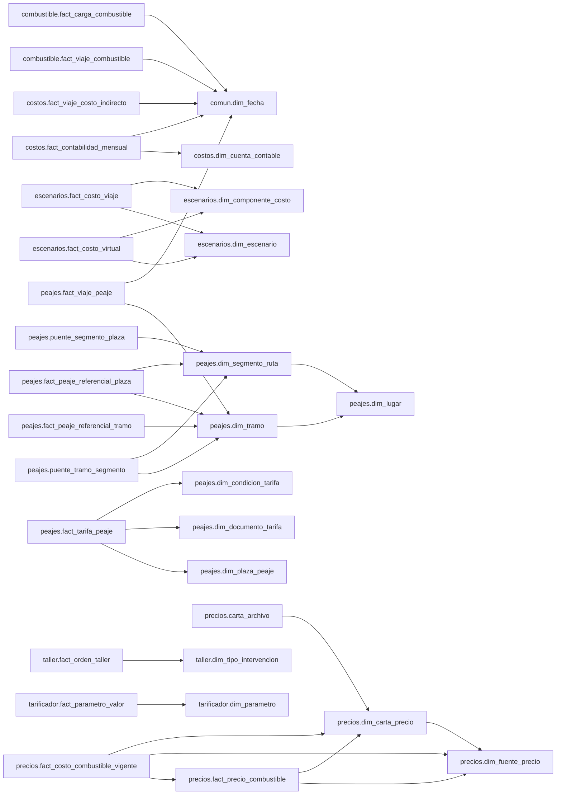

# Diccionario de datos

Generado con `python -B dw.py documentar` a partir del catálogo de PostgreSQL.

## Resumen por esquema

| Esquema | tabla | vista |
|---|---:|---:|
| ciclos | 4 | 0 |
| combustible | 12 | 3 |
| comun | 3 | 2 |
| costos | 6 | 5 |
| dim_comun | 6 | 6 |
| ds_gestion | 0 | 28 |
| escenarios | 5 | 5 |
| peajes | 15 | 4 |
| precios | 6 | 1 |
| taller | 10 | 14 |
| tarificador | 13 | 2 |
| ventas | 1 | 3 |

## Esquema `ciclos`

### `ciclos.dim_ciclo_comercial` (tabla)
- Llave primaria: `PRIMARY KEY (ciclo_comercial)`

| Columna | Tipo | Nulo | Descripción |
|---|---|---|---|
| `ciclo_comercial` | text | no |  |
| `equipo_id` | bigint | sí |  |
| `fecha_inicio` | date | sí |  |
| `fecha_fin` | date | sí |  |
| `dias` | integer | sí |  |
| `motivo_apertura` | text | sí |  |
| `motivo_cierre` | text | sí |  |
| `estado` | text | sí |  |
| `viajes` | integer | sí |  |
| `viajes_virtuales` | integer | sí |  |
| `envios` | integer | sí |  |
| `retornos` | integer | sí |  |
| `vacios` | integer | sí |  |
| `km` | double precision | sí |  |
| `km_cargado` | double precision | sí |  |
| `ingreso` | double precision | sí |  |
| `patron` | text | sí |  |
| `recorrido` | text | sí |  |
| `viaje_principal` | text | sí |  |

### `ciclos.dim_tramo_base` (tabla)
- Llave primaria: `PRIMARY KEY (sit_stretch_id)`

| Columna | Tipo | Nulo | Descripción |
|---|---|---|---|
| `sit_stretch_id` | bigint | no |  |
| `tramo` | text | sí |  |
| `km` | double precision | sí |  |
| `ciudad_origen` | text | sí |  |
| `ciudad_origen_limpia` | text | sí |  |
| `ciudad_destino` | text | sí |  |
| `ciudad_destino_limpia` | text | sí |  |
| `base_origen` | text | sí |  |
| `base_destino` | text | sí |  |
| `tipo_movimiento_base` | text | sí |  |

### `ciclos.fact_viaje_ciclo` (tabla)
- Llave primaria: `PRIMARY KEY (id_viaje)`

| Columna | Tipo | Nulo | Descripción |
|---|---|---|---|
| `id_viaje` | text | no |  |
| `nro_viaje` | bigint | sí |  |
| `equipo_id` | bigint | sí |  |
| `orden_procesado` | integer | sí |  |
| `sk_fecha` | integer | sí |  |
| `sit_stretch_id` | bigint | sí |  |
| `km` | double precision | sí |  |
| `ciudad_origen_limpia` | text | sí |  |
| `ciudad_destino_limpia` | text | sí |  |
| `base_origen` | text | sí |  |
| `base_destino` | text | sí |  |
| `cliente_id` | bigint | sí |  |
| `producto_id` | bigint | sí |  |
| `ingreso` | double precision | sí |  |
| `ingreso_por_km` | double precision | sí |  |
| `tipo_movimiento` | text | sí |  |
| `clasificacion_viaje` | text | sí |  |
| `regla_clasificacion` | text | sí |  |
| `tipo_carga_final` | text | sí |  |
| `calidad_trayectoria` | text | sí |  |
| `es_virtual` | text | sí |  |
| `tipo_virtual` | text | sí |  |
| `ciclo_comercial` | text | sí |  |
| `orden_ciclo_comercial` | integer | sí |  |
| `rol_comercial` | text | sí |  |

### `ciclos.regla_retorno` (tabla)

| Columna | Tipo | Nulo | Descripción |
|---|---|---|---|
| `orden` | integer | sí |  |
| `rompe_regla` | text | sí |  |
| `cliente_id` | bigint | sí |  |
| `razon_social` | text | sí |  |
| `carga_estricta` | text | sí |  |
| `producto_id` | bigint | sí |  |
| `tipo_carga` | text | sí |  |
| `nombre_carga` | text | sí |  |

## Esquema `combustible`

### `combustible.dim_generacion_camion` (tabla)
- Llave primaria: `PRIMARY KEY (equipo_id)`

| Columna | Tipo | Nulo | Descripción |
|---|---|---|---|
| `equipo_id` | bigint | no |  |
| `codigo` | text | sí |  |
| `modelo` | text | sí |  |
| `anio` | bigint | sí |  |
| `generacion` | text | sí |  |
| `max_cargado` | double precision | sí |  |
| `max_vacio` | double precision | sí |  |

### `combustible.fact_bloque_certificacion` (tabla)
- Llave primaria: `PRIMARY KEY (equipo_id, bloque)`

| Columna | Tipo | Nulo | Descripción |
|---|---|---|---|
| `equipo_id` | bigint | no |  |
| `bloque` | bigint | no |  |
| `t_ini` | timestamp without time zone | sí |  |
| `t_fin` | timestamp without time zone | sí |  |
| `litros` | double precision | sí |  |
| `km_viajes` | double precision | sí |  |
| `km_c` | double precision | sí |  |
| `km_v` | double precision | sí |  |
| `centro` | double precision | sí |  |
| `km_odo` | double precision | sí |  |
| `calidad` | text | sí |  |
| `sis_ini` | double precision | sí |  |
| `sis_fin` | double precision | sí |  |
| `gps_ini` | double precision | sí |  |
| `gps_fin` | double precision | sí |  |
| `km_sis` | double precision | sí |  |
| `km_gps` | double precision | sí |  |
| `grado_lectura` | text | sí |  |
| `fuente_km_cert` | text | sí |  |
| `km_cert` | double precision | sí |  |
| `razon_cert` | double precision | sí |  |
| `rend_cert` | double precision | sí |  |
| `rend_max` | double precision | sí |  |
| `motivo` | text | sí |  |
| `certificado` | boolean | sí |  |

### `combustible.fact_bloque_combustible` (tabla)
- Llave primaria: `PRIMARY KEY (equipo_id, bloque)`

| Columna | Tipo | Nulo | Descripción |
|---|---|---|---|
| `equipo_id` | bigint | no |  |
| `bloque` | integer | no |  |
| `litros` | double precision | sí |  |
| `paradas` | integer | sí |  |
| `cargas_ruta` | integer | sí |  |
| `inicio` | timestamp without time zone | sí |  |
| `termino` | timestamp without time zone | sí |  |
| `odometro_ini` | double precision | sí |  |
| `odometro_fin` | double precision | sí |  |
| `razon_habitual_camion` | double precision | sí |  |
| `bloques_unidos` | integer | sí |  |
| `viajes` | integer | sí |  |
| `km_viajes` | double precision | sí |  |
| `km_cargados` | double precision | sí |  |
| `km_vacios` | double precision | sí |  |
| `km_local` | double precision | sí |  |
| `dias` | double precision | sí |  |
| `km_odometro` | double precision | sí |  |
| `razon_odo_viajes` | double precision | sí |  |
| `razon_relativa` | double precision | sí |  |
| `rendimiento_odo` | double precision | sí |  |
| `rendimiento_viajes` | double precision | sí |  |
| `calidad` | text | sí |  |
| `anio` | integer | sí |  |
| `litros_atp` | double precision | sí |  |
| `litros_cop` | double precision | sí |  |
| `litros_otro` | double precision | sí |  |
| `litros_sin_precio` | double precision | sí |  |
| `precio_medio_litro` | double precision | sí |  |
| `costo_combustible` | double precision | sí |  |

### `combustible.fact_carga_combustible` (tabla)
- Llave foránea: `FOREIGN KEY (sk_fecha) REFERENCES comun.dim_fecha(sk_fecha)`
- Llave primaria: `PRIMARY KEY (id_carga)`

| Columna | Tipo | Nulo | Descripción |
|---|---|---|---|
| `id_carga` | bigint | no |  |
| `equipo_id` | bigint | sí |  |
| `fecha` | timestamp without time zone | sí |  |
| `sk_fecha` | integer | sí |  |
| `litros` | double precision | sí |  |
| `oilsupplier` | text | sí |  |
| `producto_id` | bigint | sí |  |
| `parada` | bigint | sí |  |
| `bloque` | integer | sí |  |
| `bloque_original` | integer | sí |  |
| `es_llenado_corte` | text | sí |  |
| `precio_litro_aplicado` | double precision | sí |  |
| `monto` | double precision | sí |  |
| `sk_carta_precio` | integer | sí |  |

### `combustible.fact_rendimiento_camion_mes` (tabla)
- Llave primaria: `PRIMARY KEY (equipo_id, mes)`

| Columna | Tipo | Nulo | Descripción |
|---|---|---|---|
| `equipo_id` | bigint | no |  |
| `mes` | text | no |  |
| `litros_mes` | double precision | sí |  |
| `bloques` | bigint | sí |  |
| `litros_cert` | double precision | sí |  |
| `km_cert` | double precision | sí |  |
| `bloques_cert` | bigint | sí |  |
| `pct_litros_cert` | double precision | sí |  |
| `rendimiento` | double precision | sí |  |
| `publicado` | boolean | sí |  |
| `mediana_12m` | double precision | sí |  |
| `desvio` | double precision | sí |  |
| `alerta` | boolean | sí |  |

### `combustible.fact_viaje_combustible` (tabla)
- Llave foránea: `FOREIGN KEY (sk_fecha_inicio) REFERENCES comun.dim_fecha(sk_fecha)`
- Llave primaria: `PRIMARY KEY (sk_viaje_comb)`

| Columna | Tipo | Nulo | Descripción |
|---|---|---|---|
| `sk_viaje_comb` | bigint | no |  |
| `nro_viaje` | bigint | sí |  |
| `id_viaje_fuente` | text | sí |  |
| `equipo_id` | bigint | sí |  |
| `orden_cadena` | double precision | sí |  |
| `sk_fecha_inicio` | integer | sí |  |
| `tramo_texto` | text | sí |  |
| `km_tramo` | double precision | sí |  |
| `tipo_movimiento` | text | sí |  |
| `vacio_fisico` | text | sí |  |
| `grupo_carga` | text | sí |  |
| `es_virtual` | text | sí |  |
| `relacion_base` | text | sí |  |
| `litros_bloque` | double precision | sí |  |
| `fraccion_cubierta` | double precision | sí |  |
| `fraccion_cubierta_ok` | double precision | sí |  |
| `litros_estimado` | double precision | sí |  |
| `litros_asignados` | double precision | sí |  |
| `metodo_asignacion` | text | sí |  |
| `id_calculo` | bigint | sí |  |
| `costo_bloque` | double precision | sí |  |
| `costo_estimado` | double precision | sí |  |
| `costo_combustible` | double precision | sí |  |
| `precio_litro_aplicado` | double precision | sí |  |
| `fraccion_certificada` | double precision | sí |  |
| `fuente_ficha` | text | sí |  |
| `l100_teorico` | double precision | sí |  |
| `litros_teoricos` | double precision | sí |  |
| `razon_real_teorico` | double precision | sí |  |
| `rendimiento_viaje` | double precision | sí |  |
| `rendimiento_max` | double precision | sí |  |
| `motivo_bloque` | text | sí |  |
| `estado_litros` | text | sí |  |
| `litros_margen` | double precision | sí |  |
| `ajuste_litros` | double precision | sí |  |
| `costo_combustible_margen` | double precision | sí |  |
| `costo_ajuste` | double precision | sí |  |
| `precio_litro_margen` | double precision | sí |  |

### `combustible.fact_viaje_combustible_tarificador` (tabla)
- Llave primaria: `PRIMARY KEY (nro_viaje)`

| Columna | Tipo | Nulo | Descripción |
|---|---|---|---|
| `nro_viaje` | bigint | no |  |
| `fecha` | date | sí |  |
| `equipo_id` | bigint | sí |  |
| `codigo_camion` | text | sí |  |
| `grupo_equipo` | text | sí |  |
| `sk_tramo` | bigint | sí |  |
| `km_tramo` | double precision | sí |  |
| `precio_base` | double precision | sí |  |
| `precio_ruta` | double precision | sí |  |
| `pct_base` | double precision | sí |  |
| `recargo_precio` | double precision | sí |  |
| `precio_ponderado` | double precision | sí |  |
| `rendimiento_camion` | double precision | sí |  |
| `bloques_rendimiento` | integer | sí |  |
| `fecha_ultimo_bloque` | timestamp without time zone | sí |  |
| `litros_rend_camion` | double precision | sí |  |
| `costo_rend_camion` | double precision | sí |  |
| `rendimiento_tarificador` | double precision | sí |  |
| `litros_tarificador` | double precision | sí |  |
| `costo_tarificador` | double precision | sí |  |
| `estado` | text | sí |  |

### `combustible.param_ficha_consumo` (tabla)
- Llave primaria: `PRIMARY KEY (equipo_id, mes)`

| Columna | Tipo | Nulo | Descripción |
|---|---|---|---|
| `equipo_id` | bigint | no |  |
| `mes` | text | no |  |
| `generacion` | text | sí |  |
| `bloques_cert_12m` | bigint | sí |  |
| `fuente` | text | sí |  |
| `l100_cargado` | double precision | sí |  |
| `l100_vacio` | double precision | sí |  |
| `kml_cargado` | double precision | sí |  |
| `kml_vacio` | double precision | sí |  |
| `vigente_desde` | date | sí |  |
| `vigente_hasta` | date | sí |  |

### `combustible.parametro_certificacion` (tabla)
- Llave primaria: `PRIMARY KEY (parametro, vigente_desde)`

| Columna | Tipo | Nulo | Descripción |
|---|---|---|---|
| `parametro` | text | no |  |
| `vigente_desde` | date | no |  |
| `vigente_hasta` | date | no |  |
| `valor` | jsonb | no |  |
| `fuente_sha256` | text | no |  |

### `combustible.parametro_rendimiento_tarificador` (tabla)
- Llave primaria: `PRIMARY KEY (parametro, vigente_desde)`

| Columna | Tipo | Nulo | Descripción |
|---|---|---|---|
| `parametro` | text | no |  |
| `valor` | integer | no |  |
| `vigente_desde` | date | no |  |
| `vigente_hasta` | date | no |  |

### `combustible.puente_viaje_bloque` (tabla)

| Columna | Tipo | Nulo | Descripción |
|---|---|---|---|
| `equipo_id` | bigint | sí |  |
| `bloque` | integer | sí |  |
| `id_calculo` | bigint | sí |  |
| `id_viaje_fuente` | text | sí |  |
| `nro_viaje` | bigint | sí |  |
| `es_virtual` | text | sí |  |
| `fraccion_viaje` | double precision | sí |  |
| `km_tramo_parte` | double precision | sí |  |
| `km_ponderados` | double precision | sí |  |
| `km_ponderados_bloque` | double precision | sí |  |
| `litros_asignados` | double precision | sí |  |
| `costo_asignado` | double precision | sí |  |
| `calidad_bloque` | text | sí |  |

### `combustible.ref_regresion_camion` (tabla)
- Llave primaria: `PRIMARY KEY (equipo_id)`

| Columna | Tipo | Nulo | Descripción |
|---|---|---|---|
| `equipo_id` | bigint | no |  |
| `codigo` | text | sí |  |
| `modelo` | text | sí |  |
| `bloques` | integer | sí |  |
| `l100_cargado` | double precision | sí |  |
| `error_cargado` | double precision | sí |  |
| `l100_vacio` | double precision | sí |  |
| `error_vacio` | double precision | sí |  |
| `peso_cargado_vs_vacio` | double precision | sí |  |
| `km_cargado_pct` | double precision | sí |  |

### `combustible.v_alerta_certificacion_mensual` (vista)

| Columna | Tipo | Nulo | Descripción |
|---|---|---|---|
| `mes` | date | sí |  |
| `fraccion_certificada` | double precision | sí |  |

### `combustible.v_litros_no_asignables` (vista)

| Columna | Tipo | Nulo | Descripción |
|---|---|---|---|
| `anio` | integer | sí |  |
| `motivo_bloque` | text | sí |  |
| `viajes` | bigint | sí |  |
| `litros_asignados` | double precision | sí |  |
| `litros_margen` | double precision | sí |  |
| `ajuste_litros` | double precision | sí |  |
| `costo_ajuste` | double precision | sí |  |

### `combustible.v_rendimiento_tarificador_certificado` (vista)

| Columna | Tipo | Nulo | Descripción |
|---|---|---|---|
| `nro_viaje` | bigint | sí |  |
| `equipo_id` | bigint | sí |  |
| `fecha_documental_id` | integer | sí |  |
| `ventana_bloques` | integer | sí |  |
| `rendimiento_camion` | double precision | sí |  |
| `bloques_utilizados` | integer | sí |  |
| `fecha_ultimo_bloque` | timestamp without time zone | sí |  |
| `fecha_primer_bloque` | timestamp without time zone | sí |  |
| `bloques_utilizados_ids` | bigint[] | sí |  |
| `rendimiento_supuesto` | boolean | sí |  |
| `origen_rendimiento` | text | sí |  |
| `rendimiento_previo` | double precision | sí |  |
| `bloques_previos` | integer | sí |  |
| `fecha_ultimo_previo` | timestamp without time zone | sí |  |

## Esquema `comun`

### `comun.dim_fecha` (tabla)
- Llave primaria: `PRIMARY KEY (sk_fecha)`
- Única: `UNIQUE (fecha)`

| Columna | Tipo | Nulo | Descripción |
|---|---|---|---|
| `sk_fecha` | integer | no |  |
| `fecha` | date | sí |  |
| `anio` | integer | sí |  |
| `mes` | integer | sí |  |
| `dia` | integer | sí |  |
| `dia_semana` | integer | sí |  |
| `nombre_dia` | text | sí |  |
| `es_fin_de_semana` | text | sí |  |

### `comun.registro_carga` (tabla)
- Llave primaria: `PRIMARY KEY (id)`

| Columna | Tipo | Nulo | Descripción |
|---|---|---|---|
| `id` | bigint | no |  |
| `area` | text | sí |  |
| `fecha_carga` | timestamp without time zone | sí |  |
| `version_script` | text | sí |  |
| `fecha_cambio` | text | sí |  |
| `detalle` | text | sí |  |

### `comun.registro_ejecucion` (tabla)
- Llave primaria: `PRIMARY KEY (id)`

| Columna | Tipo | Nulo | Descripción |
|---|---|---|---|
| `id` | text | no |  |
| `fecha` | timestamp with time zone | sí |  |
| `manifiesto` | jsonb | sí |  |

### `comun.v_fact_viaje` (vista)

| Columna | Tipo | Nulo | Descripción |
|---|---|---|---|
| `nro_viaje` | bigint | sí |  |
| `nro_hoja_ruta` | bigint | sí |  |
| `fecha` | date | sí |  |
| `sk_tramo` | bigint | sí |  |
| `texto_tramo` | text | sí |  |
| `es_retorno` | text | sí |  |
| `peaje_referencial` | double precision | sí |  |
| `peaje_referencial_maximo` | double precision | sí |  |
| `estado_peaje` | text | sí |  |
| `equipo_id` | bigint | sí |  |
| `orden_cadena` | double precision | sí |  |
| `km_tramo` | double precision | sí |  |
| `tipo_movimiento` | text | sí |  |
| `vacio_fisico` | text | sí |  |
| `grupo_carga` | text | sí |  |
| `litros_asignados` | double precision | sí |  |
| `metodo_asignacion_comb` | text | sí |  |
| `costo_combustible` | double precision | sí |  |
| `precio_litro_comb` | double precision | sí |  |
| `cliente_id` | bigint | sí |  |
| `cliente` | text | sí |  |
| `producto_id` | bigint | sí |  |
| `producto_viaje` | text | sí |  |
| `tipo_operador` | text | sí |  |
| `tracto_id` | bigint | sí |  |
| `rampla_id` | bigint | sí |  |
| `conductor_interno` | text | sí |  |
| `estado_viaje` | text | sí |  |
| `ingreso` | double precision | sí |  |
| `valor_facturado` | double precision | sí |  |
| `comision_conductor` | double precision | sí |  |
| `pago_tercero` | double precision | sí |  |
| `pct_pago_tercero` | double precision | sí |  |
| `comision_conductor_observada` | double precision | sí |  |
| `pago_tercero_observado` | double precision | sí |  |
| `orden_procesado` | integer | sí |  |
| `clasificacion_viaje` | text | sí |  |
| `regla_clasificacion` | text | sí |  |
| `tipo_carga_final` | text | sí |  |
| `calidad_trayectoria` | text | sí |  |
| `ciclo_comercial` | text | sí |  |
| `rol_comercial` | text | sí |  |
| `precio_litro_tarificador` | double precision | sí |  |
| `rendimiento_camion` | double precision | sí |  |
| `costo_comb_rend_camion` | double precision | sí |  |
| `costo_comb_tarificador` | double precision | sí |  |
| `estado_comb_tarificador` | text | sí |  |
| `es_flota_propia` | text | sí |  |
| `es_tractoreo` | text | sí |  |
| `km_tramo_costos` | double precision | sí |  |
| `dias_viaje` | double precision | sí |  |
| `usa_rampla_callegari` | text | sí |  |
| `costo_fijo_asignado` | double precision | sí |  |
| `reposicion_asignada` | double precision | sí |  |
| `costo_neumatico_asignado` | double precision | sí |  |
| `costo_indirecto_total` | double precision | sí |  |
| `estado_costo_indirecto` | text | sí |  |
| `costo_fijo_propuesto` | double precision | sí |  |
| `cf_flota` | double precision | sí |  |
| `cf_rampla` | double precision | sí |  |
| `cf_estructura` | double precision | sí |  |
| `cf_directo_fleteros` | double precision | sí |  |
| `reposicion_propuesta` | double precision | sí |  |
| `neumatico_propuesto` | double precision | sí |  |
| `costo_indirecto_propuesto` | double precision | sí |  |
| `estado_costo_propuesto` | text | sí |  |

### `comun.v_margen_viaje` (vista)

| Columna | Tipo | Nulo | Descripción |
|---|---|---|---|
| `nro_viaje` | bigint | sí |  |
| `nro_hoja_ruta` | bigint | sí |  |
| `fecha` | date | sí |  |
| `sk_tramo` | bigint | sí |  |
| `texto_tramo` | text | sí |  |
| `es_retorno` | text | sí |  |
| `peaje_referencial` | double precision | sí |  |
| `peaje_referencial_maximo` | double precision | sí |  |
| `estado_peaje` | text | sí |  |
| `equipo_id` | bigint | sí |  |
| `orden_cadena` | double precision | sí |  |
| `km_tramo` | double precision | sí |  |
| `tipo_movimiento` | text | sí |  |
| `vacio_fisico` | text | sí |  |
| `grupo_carga` | text | sí |  |
| `litros_asignados` | double precision | sí |  |
| `metodo_asignacion_comb` | text | sí |  |
| `costo_combustible` | double precision | sí |  |
| `precio_litro_comb` | double precision | sí |  |
| `cliente_id` | bigint | sí |  |
| `cliente` | text | sí |  |
| `producto_id` | bigint | sí |  |
| `producto_viaje` | text | sí |  |
| `tipo_operador` | text | sí |  |
| `tracto_id` | bigint | sí |  |
| `rampla_id` | bigint | sí |  |
| `conductor_interno` | text | sí |  |
| `estado_viaje` | text | sí |  |
| `ingreso` | double precision | sí |  |
| `valor_facturado` | double precision | sí |  |
| `comision_conductor` | double precision | sí |  |
| `pago_tercero` | double precision | sí |  |
| `pct_pago_tercero` | double precision | sí |  |
| `comision_conductor_observada` | double precision | sí |  |
| `pago_tercero_observado` | double precision | sí |  |
| `orden_procesado` | integer | sí |  |
| `clasificacion_viaje` | text | sí |  |
| `regla_clasificacion` | text | sí |  |
| `tipo_carga_final` | text | sí |  |
| `calidad_trayectoria` | text | sí |  |
| `ciclo_comercial` | text | sí |  |
| `rol_comercial` | text | sí |  |
| `precio_litro_tarificador` | double precision | sí |  |
| `rendimiento_camion` | double precision | sí |  |
| `costo_comb_rend_camion` | double precision | sí |  |
| `costo_comb_tarificador` | double precision | sí |  |
| `estado_comb_tarificador` | text | sí |  |
| `es_flota_propia` | text | sí |  |
| `es_tractoreo` | text | sí |  |
| `km_tramo_costos` | double precision | sí |  |
| `dias_viaje` | double precision | sí |  |
| `usa_rampla_callegari` | text | sí |  |
| `costo_fijo_asignado` | double precision | sí |  |
| `reposicion_asignada` | double precision | sí |  |
| `costo_neumatico_asignado` | double precision | sí |  |
| `costo_indirecto_total` | double precision | sí |  |
| `estado_costo_indirecto` | text | sí |  |
| `costo_fijo_propuesto` | double precision | sí |  |
| `cf_flota` | double precision | sí |  |
| `cf_rampla` | double precision | sí |  |
| `cf_estructura` | double precision | sí |  |
| `cf_directo_fleteros` | double precision | sí |  |
| `reposicion_propuesta` | double precision | sí |  |
| `neumatico_propuesto` | double precision | sí |  |
| `costo_indirecto_propuesto` | double precision | sí |  |
| `estado_costo_propuesto` | text | sí |  |
| `margen_contribucion` | double precision | sí |  |
| `margen_contribucion_comb_estimado` | double precision | sí |  |
| `margen_operacional` | double precision | sí |  |
| `cobertura_margen` | text | sí |  |
| `margen_operacional_comercial` | double precision | sí |  |
| `costos_fisicos_completos` | boolean | sí |  |
| `costos_comerciales_completos` | boolean | sí |  |
| `costo_fisico_escenario_3` | double precision | sí |  |
| `costo_comercial_escenario_3` | double precision | sí |  |
| `definicion_margen_operacional` | text | sí |  |
| `definicion_margen_comercial` | text | sí |  |
| `alcance_contribucion` | text | sí |  |
| `cobertura_contribucion` | text | sí |  |
| `cobertura_contribucion_comb_estimado` | text | sí |  |

## Esquema `costos`

### `costos.dim_centro_costo` (tabla)
- Llave primaria: `PRIMARY KEY (c_activity_id)`

| Columna | Tipo | Nulo | Descripción |
|---|---|---|---|
| `c_activity_id` | bigint | no |  |
| `nombre` | text | sí |  |
| `bolsa` | text | sí |  |
| `rol` | text | sí |  |
| `origen` | text | sí |  |

### `costos.dim_cuenta_contable` (tabla)
- Llave primaria: `PRIMARY KEY (sk_cuenta)`
- Única: `UNIQUE (codigo)`

| Columna | Tipo | Nulo | Descripción |
|---|---|---|---|
| `sk_cuenta` | integer | no |  |
| `codigo` | text | sí |  |
| `nombre` | text | sí |  |
| `tipo` | text | sí |  |
| `linea_eerr` | text | sí |  |
| `nombre_linea_eerr` | text | sí |  |
| `clase_tarificador` | text | sí |  |
| `clase_real` | text | sí |  |
| `inductor` | text | sí |  |
| `origen_clasificacion` | text | sí |  |
| `nota` | text | sí |  |

### `costos.fact_capacidad_bolsa` (tabla)
- Llave primaria: `PRIMARY KEY (anio, bolsa)`

| Columna | Tipo | Nulo | Descripción |
|---|---|---|---|
| `anio` | integer | no |  |
| `bolsa` | text | no |  |
| `monto_bolsa` | numeric(18,2) | sí |  |
| `capacidad_dias` | numeric(18,2) | sí |  |
| `cuota_media` | numeric(18,2) | sí |  |
| `dias_usados` | numeric(18,2) | sí |  |
| `absorbido` | numeric(18,2) | sí |  |
| `capacidad_ociosa` | numeric(18,2) | sí |  |
| `pct_absorbido` | numeric(8,4) | sí |  |

### `costos.fact_contabilidad_mensual` (tabla)
- Llave foránea: `FOREIGN KEY (sk_cuenta) REFERENCES costos.dim_cuenta_contable(sk_cuenta)`
- Llave foránea: `FOREIGN KEY (sk_fecha_mes) REFERENCES comun.dim_fecha(sk_fecha)`

| Columna | Tipo | Nulo | Descripción |
|---|---|---|---|
| `sk_fecha_mes` | integer | sí |  |
| `anio` | integer | sí |  |
| `mes` | integer | sí |  |
| `sk_cuenta` | integer | sí |  |
| `unidad_negocio_id` | bigint | sí |  |
| `equipo_id` | bigint | sí |  |
| `es_un_fleteros` | text | sí |  |
| `c_activity_id` | bigint | sí |  |
| `monto` | numeric(16,2) | sí |  |
| `n_lineas` | integer | sí |  |
| `bolsa` | text | sí |  |

### `costos.fact_viaje_costo_indirecto` (tabla)
- Llave foránea: `FOREIGN KEY (sk_fecha_inicio) REFERENCES comun.dim_fecha(sk_fecha)`
- Llave primaria: `PRIMARY KEY (nro_viaje, metodo)`

| Columna | Tipo | Nulo | Descripción |
|---|---|---|---|
| `nro_viaje` | bigint | no |  |
| `metodo` | text | no |  |
| `sk_fecha_inicio` | integer | sí |  |
| `sit_stretch_id` | bigint | sí |  |
| `equipo_id` | bigint | sí |  |
| `rampla_id` | bigint | sí |  |
| `operador` | text | sí |  |
| `es_flota_propia` | text | sí |  |
| `es_tractoreo` | text | sí |  |
| `usa_rampla_callegari` | text | sí |  |
| `km_tramo` | double precision | sí |  |
| `dias_viaje` | double precision | sí |  |
| `costo_fijo_asignado` | double precision | sí |  |
| `cf_flota` | double precision | sí |  |
| `cf_rampla` | double precision | sí |  |
| `cf_estructura` | double precision | sí |  |
| `cf_directo_fleteros` | double precision | sí |  |
| `reposicion_asignada` | double precision | sí |  |
| `costo_neumatico_asignado` | double precision | sí |  |
| `costo_indirecto_total` | double precision | sí |  |
| `tasa_costo_fijo_aplicada` | double precision | sí |  |
| `tasa_reposicion_aplicada` | double precision | sí |  |
| `tasa_neumatico_aplicada` | double precision | sí |  |
| `km_por_dia_aplicado` | double precision | sí |  |
| `estado_costo_indirecto` | text | sí |  |

### `costos.parametro_costo` (tabla)
- Llave primaria: `PRIMARY KEY (parametro, metodo, ambito, vigente_desde)`

| Columna | Tipo | Nulo | Descripción |
|---|---|---|---|
| `parametro` | text | no |  |
| `metodo` | text | no |  |
| `ambito` | text | no |  |
| `valor` | numeric(18,6) | sí |  |
| `unidad` | text | sí |  |
| `vigente_desde` | date | no |  |
| `vigente_hasta` | date | sí |  |
| `parametro_padre` | text | sí |  |
| `origen` | text | sí |  |
| `fuente_detalle` | text | sí |  |
| `monto_base` | numeric(18,2) | sí |  |
| `cantidad_inductor` | numeric(18,4) | sí |  |
| `nota` | text | sí |  |

### `costos.v_cobertura_referencias_mensual` (vista)

Montos bajo alcance contable del ETL: neto y absoluto de grupos; no equivale a movimientos brutos ni balance completo. Las referencias desconocidas no se eliminan.

| Columna | Tipo | Nulo | Descripción |
|---|---|---|---|
| `anio` | integer | sí |  |
| `mes` | integer | sí |  |
| `estado_descripcion_centro` | text | sí |  |
| `estado_descripcion_un` | text | sí |  |
| `estado_asignacion_equipo` | text | sí |  |
| `grupos_contables` | bigint | sí |  |
| `lineas_fuente` | bigint | sí |  |
| `monto_neto` | numeric | sí |  |
| `suma_absoluta_montos_agrupados` | numeric | sí |  |

### `costos.v_ref_centro_contable` (vista)

| Columna | Tipo | Nulo | Descripción |
|---|---|---|---|
| `c_activity_id` | bigint | sí |  |
| `nombre` | text | sí |  |
| `estado_descripcion` | text | sí |  |
| `origen_descripcion` | text | sí |  |

### `costos.v_ref_unidad_negocio` (vista)

IDs observados y correspondencia con fotografía actual de equipos. No acredita relación histórica ni identifica toda UN como vehículo.

| Columna | Tipo | Nulo | Descripción |
|---|---|---|---|
| `unidad_negocio_id` | bigint | sí |  |
| `nombre` | text | sí |  |
| `estado_descripcion` | text | sí |  |
| `equipos_actuales` | bigint | sí |  |
| `equipo_unico_actual` | bigint | sí |  |
| `estado_correspondencia` | text | sí |  |

### `costos.v_referencias_contabilidad` (vista)

| Columna | Tipo | Nulo | Descripción |
|---|---|---|---|
| `sk_fecha_mes` | integer | sí |  |
| `anio` | integer | sí |  |
| `mes` | integer | sí |  |
| `sk_cuenta` | integer | sí |  |
| `unidad_negocio_id` | bigint | sí |  |
| `equipo_id` | bigint | sí |  |
| `es_un_fleteros` | text | sí |  |
| `c_activity_id` | bigint | sí |  |
| `monto` | numeric(16,2) | sí |  |
| `n_lineas` | integer | sí |  |
| `bolsa` | text | sí |  |
| `estado_descripcion_centro` | text | sí |  |
| `estado_descripcion_un` | text | sí |  |
| `correspondencia_un_actual` | text | sí |  |
| `equipo_candidato_actual` | bigint | sí |  |
| `estado_asignacion_equipo` | text | sí |  |

### `costos.v_reglas_centro_costo` (vista)

Proyección de las reglas existentes. No es un catálogo empresarial ni una nueva fuente de asignación.

| Columna | Tipo | Nulo | Descripción |
|---|---|---|---|
| `c_activity_id` | bigint | sí |  |
| `bolsa` | text | sí |  |
| `rol` | text | sí |  |

## Esquema `dim_comun`

### `dim_comun.dim_conductor` (tabla)
- Llave primaria: `PRIMARY KEY (conductor_id)`

| Columna | Tipo | Nulo | Descripción |
|---|---|---|---|
| `conductor_id` | bigint | no |  |
| `conductor_origen_id` | bigint | sí |  |
| `nombre_completo` | text | sí |  |
| `forhire_fuente` | text | sí |  |
| `activo_fuente` | text | sí |  |
| `estado_fuente` | text | sí |  |
| `actualizado_fuente` | text | sí |  |
| `extraccion_id` | text | sí |  |
| `fuente_sha256` | text | sí |  |

### `dim_comun.dim_equipo` (tabla)
- Llave primaria: `PRIMARY KEY (equipo_id)`

| Columna | Tipo | Nulo | Descripción |
|---|---|---|---|
| `equipo_id` | bigint | no |  |
| `codigo` | text | sí |  |
| `patente` | text | sí |  |
| `nombre_fuente` | text | sí |  |
| `categoria_fuente` | text | sí |  |
| `marca` | text | sí |  |
| `modelo` | text | sí |  |
| `anio_fabricacion_fuente` | text | sí |  |
| `es_flota_fuente` | text | sí |  |
| `es_propio_fuente` | text | sí |  |
| `estado_fuente` | text | sí |  |
| `grupo_empresa_fuente` | text | sí |  |
| `centro_costo_id` | bigint | sí |  |
| `unidad_negocio_id` | bigint | sí |  |
| `activo_fuente` | text | sí |  |
| `actualizado_fuente` | text | sí |  |
| `extraccion_id` | text | sí |  |
| `fuente_sha256` | text | sí |  |

### `dim_comun.dim_fecha` (vista)

| Columna | Tipo | Nulo | Descripción |
|---|---|---|---|
| `sk_fecha` | integer | sí |  |
| `fecha` | date | sí |  |
| `anio` | integer | sí |  |
| `mes` | integer | sí |  |
| `dia` | integer | sí |  |
| `dia_semana` | integer | sí |  |

### `dim_comun.dim_producto_viaje` (tabla)
- Llave primaria: `PRIMARY KEY (producto_id)`

| Columna | Tipo | Nulo | Descripción |
|---|---|---|---|
| `producto_id` | bigint | no |  |
| `producto` | text | sí |  |
| `control_temperatura_fuente` | text | sí |  |
| `multicarga_fuente` | text | sí |  |
| `viaje_vacio_fuente` | text | sí |  |
| `activo_fuente` | text | sí |  |
| `actualizado_fuente` | text | sí |  |
| `extraccion_id` | text | sí |  |
| `fuente_sha256` | text | sí |  |

### `dim_comun.dim_socio_negocio` (tabla)
- Llave primaria: `PRIMARY KEY (socio_id)`

| Columna | Tipo | Nulo | Descripción |
|---|---|---|---|
| `socio_id` | bigint | no |  |
| `razon_social` | text | sí |  |
| `es_cliente_fuente` | text | sí |  |
| `es_proveedor_fuente` | text | sí |  |
| `forhire_fuente` | text | sí |  |
| `flota_mixta_fuente` | text | sí |  |
| `activo_fuente` | text | sí |  |
| `actualizado_fuente` | text | sí |  |
| `extraccion_id` | text | sí |  |
| `fuente_sha256` | text | sí |  |

### `dim_comun.dim_tramo_comercial` (tabla)
- Llave primaria: `PRIMARY KEY (tramo_id)`

| Columna | Tipo | Nulo | Descripción |
|---|---|---|---|
| `tramo_id` | bigint | no |  |
| `nombre_fuente` | text | sí |  |
| `km_fuente` | double precision | sí |  |
| `activo_fuente` | text | sí |  |
| `actualizado_fuente` | text | sí |  |
| `extraccion_id` | text | sí |  |
| `fuente_sha256` | text | sí |  |

### `dim_comun.roles_socio` (tabla)
- Llave primaria: `PRIMARY KEY (socio_id, rol)`

| Columna | Tipo | Nulo | Descripción |
|---|---|---|---|
| `socio_id` | bigint | no |  |
| `rol` | text | no |  |
| `usado_en_viajes` | boolean | sí |  |
| `marca_fuente` | text | sí |  |

### `dim_comun.v_dim_equipo` (vista)

| Columna | Tipo | Nulo | Descripción |
|---|---|---|---|
| `equipo_id` | bigint | sí |  |
| `codigo` | text | sí |  |
| `patente` | text | sí |  |
| `nombre_fuente` | text | sí |  |
| `categoria_fuente` | text | sí |  |
| `marca` | text | sí |  |
| `modelo` | text | sí |  |
| `anio_fabricacion_fuente` | text | sí |  |
| `es_flota_fuente` | text | sí |  |
| `es_propio_fuente` | text | sí |  |
| `estado_fuente` | text | sí |  |
| `grupo_empresa_fuente` | text | sí |  |
| `centro_costo_id` | bigint | sí |  |
| `unidad_negocio_id` | bigint | sí |  |
| `activo_fuente` | text | sí |  |
| `actualizado_fuente` | text | sí |  |
| `extraccion_id` | text | sí |  |
| `fuente_sha256` | text | sí |  |
| `tipo_equipo_derivado` | text | sí |  |

### `dim_comun.v_dim_otros_equipos` (vista)

| Columna | Tipo | Nulo | Descripción |
|---|---|---|---|
| `equipo_id` | bigint | sí |  |
| `codigo` | text | sí |  |
| `patente` | text | sí |  |
| `nombre_fuente` | text | sí |  |
| `categoria_fuente` | text | sí |  |
| `marca` | text | sí |  |
| `modelo` | text | sí |  |
| `anio_fabricacion_fuente` | text | sí |  |
| `es_flota_fuente` | text | sí |  |
| `es_propio_fuente` | text | sí |  |
| `estado_fuente` | text | sí |  |
| `grupo_empresa_fuente` | text | sí |  |
| `centro_costo_id` | bigint | sí |  |
| `unidad_negocio_id` | bigint | sí |  |
| `activo_fuente` | text | sí |  |
| `actualizado_fuente` | text | sí |  |
| `extraccion_id` | text | sí |  |
| `fuente_sha256` | text | sí |  |
| `tipo_equipo_derivado` | text | sí |  |

### `dim_comun.v_dim_rampla` (vista)

| Columna | Tipo | Nulo | Descripción |
|---|---|---|---|
| `equipo_id` | bigint | sí |  |
| `codigo` | text | sí |  |
| `patente` | text | sí |  |
| `nombre_fuente` | text | sí |  |
| `categoria_fuente` | text | sí |  |
| `marca` | text | sí |  |
| `modelo` | text | sí |  |
| `anio_fabricacion_fuente` | text | sí |  |
| `es_flota_fuente` | text | sí |  |
| `es_propio_fuente` | text | sí |  |
| `estado_fuente` | text | sí |  |
| `grupo_empresa_fuente` | text | sí |  |
| `centro_costo_id` | bigint | sí |  |
| `unidad_negocio_id` | bigint | sí |  |
| `activo_fuente` | text | sí |  |
| `actualizado_fuente` | text | sí |  |
| `extraccion_id` | text | sí |  |
| `fuente_sha256` | text | sí |  |
| `tipo_equipo_derivado` | text | sí |  |

### `dim_comun.v_dim_tracto` (vista)

| Columna | Tipo | Nulo | Descripción |
|---|---|---|---|
| `equipo_id` | bigint | sí |  |
| `codigo` | text | sí |  |
| `patente` | text | sí |  |
| `nombre_fuente` | text | sí |  |
| `categoria_fuente` | text | sí |  |
| `marca` | text | sí |  |
| `modelo` | text | sí |  |
| `anio_fabricacion_fuente` | text | sí |  |
| `es_flota_fuente` | text | sí |  |
| `es_propio_fuente` | text | sí |  |
| `estado_fuente` | text | sí |  |
| `grupo_empresa_fuente` | text | sí |  |
| `centro_costo_id` | bigint | sí |  |
| `unidad_negocio_id` | bigint | sí |  |
| `activo_fuente` | text | sí |  |
| `actualizado_fuente` | text | sí |  |
| `extraccion_id` | text | sí |  |
| `fuente_sha256` | text | sí |  |
| `tipo_equipo_derivado` | text | sí |  |

### `dim_comun.v_tramo_version_peaje` (vista)

| Columna | Tipo | Nulo | Descripción |
|---|---|---|---|
| `sk_tramo` | bigint | sí |  |
| `tramo_id` | bigint | sí |  |
| `nombre_version_peaje` | text | sí |  |
| `km_erp_peaje` | double precision | sí |  |
| `km_ruta_calculada` | double precision | sí |  |
| `vigente_desde` | date | sí |  |
| `vigente_hasta` | date | sí |  |
| `es_actual` | text | sí |  |
| `nombre_catalogo_actual` | text | sí |  |
| `estado_maestro` | text | sí |  |

## Esquema `ds_gestion`

### `ds_gestion.v_capacidad_flota_modelada_mensual` (vista)

| Columna | Tipo | Nulo | Descripción |
|---|---|---|---|
| `mes_id` | integer | sí |  |
| `mes` | text | sí |  |
| `anio` | integer | sí |  |
| `desde` | text | sí |  |
| `hasta` | text | sí |  |
| `parcial` | boolean | sí |  |
| `dias_calendario` | bigint | sí |  |
| `capacidad_completa` | boolean | sí |  |
| `dias_capacidad` | double precision | sí |  |
| `dias_reales_conocidos` | double precision | sí |  |
| `dias_virtuales_conocidos` | double precision | sí |  |
| `dias_actividad_conocida` | double precision | sí |  |
| `brecha_modelada` | double precision | sí |  |
| `viajes` | bigint | sí |  |
| `virtuales` | bigint | sí |  |
| `referencias_dias_faltantes` | bigint | sí |  |
| `alcance` | text | sí |  |

### `ds_gestion.v_capacidad_periodica` (vista)

| Columna | Tipo | Nulo | Descripción |
|---|---|---|---|
| `mes` | text | sí |  |
| `anio` | integer | sí |  |
| `bolsa` | text | sí |  |
| `desde` | date | sí |  |
| `hasta` | date | sí |  |
| `parcial` | boolean | sí |  |
| `presupuesto` | double precision | sí |  |
| `absorcion_real` | double precision | sí |  |
| `absorcion_virtual_conocida` | double precision | sí |  |
| `absorcion_conocida` | double precision | sí |  |
| `residual_provisional` | double precision | sí |  |
| `porcentaje_absorbido` | double precision | sí |  |
| `presupuesto_completo` | boolean | sí |  |
| `viajes` | bigint | sí |  |
| `viajes_pendientes` | bigint | sí |  |
| `virtuales` | bigint | sí |  |
| `virtuales_pendientes` | bigint | sí |  |
| `alcance` | text | sí |  |

### `ds_gestion.v_ciclo` (vista)

| Columna | Tipo | Nulo | Descripción |
|---|---|---|---|
| `ciclo_id` | text | sí |  |
| `movimiento_principal_id` | text | sí |  |
| `nro_viaje_principal` | bigint | sí |  |
| `fecha_documental_principal_id` | integer | sí |  |
| `cliente_principal_id` | bigint | sí |  |
| `cliente_principal` | text | sí |  |
| `producto_principal_id` | bigint | sí |  |
| `producto_principal` | text | sí |  |
| `tramo_principal_id` | bigint | sí |  |
| `tramo_principal` | text | sí |  |
| `origen_principal` | text | sí |  |
| `destino_principal` | text | sí |  |
| `equipo_id` | bigint | sí |  |
| `equipo_codigo` | text | sí |  |
| `equipo_nombre` | text | sí |  |
| `conductor_nombre` | text | sí |  |
| `operador_principal` | text | sí |  |
| `en_alcance_rentabilidad` | boolean | sí |  |
| `inicio_documental` | date | sí |  |
| `fin_documental` | date | sí |  |
| `motivo_apertura` | text | sí |  |
| `motivo_cierre` | text | sí |  |
| `tipo_segmento` | text | sí |  |
| `recorrido_completo` | text | sí |  |
| `patron_recorrido` | text | sí |  |
| `contiene_retorno` | boolean | sí |  |
| `reales` | bigint | sí |  |
| `virtuales` | bigint | sí |  |
| `retornos_reales` | bigint | sí |  |
| `retornos_propios` | bigint | sí |  |
| `retornos_terceros` | bigint | sí |  |
| `envios_adicionales` | bigint | sí |  |

### `ds_gestion.v_ciclo_politica` (vista)

| Columna | Tipo | Nulo | Descripción |
|---|---|---|---|
| `ciclo_id` | text | sí |  |
| `escenario_id` | integer | sí |  |
| `politica_id` | text | sí |  |
| `politica` | text | sí |  |
| `version_regla` | integer | sí |  |
| `evaluable` | boolean | sí |  |
| `motivo` | text | sí |  |
| `fecha_documental_principal_id` | integer | sí |  |
| `ingreso_estimado` | double precision | sí |  |
| `costo_comercial` | double precision | sí |  |
| `margen_comercial` | double precision | sí |  |
| `submotivo_estructura` | text | sí |  |
| `condiciones_estructura` | text | sí |  |
| `estructura_conservadora` | boolean | sí |  |
| `estructura_flexible` | boolean | sí |  |
| `propios` | boolean | sí |  |
| `ingreso_completo` | boolean | sí |  |
| `costos_reales_completos` | boolean | sí |  |
| `costos_virtuales_completos` | boolean | sí |  |
| `metodo_virtual_disponible` | boolean | sí |  |
| `recorrido_movimientos` | text | sí |  |
| `conexiones` | text | sí |  |

### `ds_gestion.v_combustible_certificado` (vista)

| Columna | Tipo | Nulo | Descripción |
|---|---|---|---|
| `movimiento_cadena_id` | text | sí |  |
| `nro_viaje` | bigint | sí |  |
| `equipo_id` | bigint | sí |  |
| `fecha_documental_id` | integer | sí |  |
| `litros_asignados` | double precision | sí |  |
| `litros_margen` | double precision | sí |  |
| `ajuste_litros` | double precision | sí |  |
| `estado_litros` | text | sí |  |
| `fraccion_certificada` | double precision | sí |  |
| `fuente_ficha` | text | sí |  |
| `motivo_bloque` | text | sí |  |
| `precio_litro_margen` | double precision | sí |  |
| `costo_original` | double precision | sí |  |
| `costo_combustible_margen` | double precision | sí |  |
| `costo_ajuste` | double precision | sí |  |

### `ds_gestion.v_componente` (vista)

| Columna | Tipo | Nulo | Descripción |
|---|---|---|---|
| `componente_id` | integer | sí |  |
| `nombre` | text | sí |  |
| `unidad` | text | sí |  |
| `tipo` | text | sí |  |

### `ds_gestion.v_conciliacion_operacional_mensual` (vista)

| Columna | Tipo | Nulo | Descripción |
|---|---|---|---|
| `mes_id` | integer | sí |  |
| `sk_escenario` | integer | sí |  |
| `viajes_reales` | bigint | sí |  |
| `ingresos_faltantes` | bigint | sí |  |
| `ingreso_estimado_conocido` | numeric | sí |  |
| `facturado_por_fecha_viaje` | numeric | sí |  |
| `ultima_fecha_viaje` | integer | sí |  |
| `registros_componentes` | bigint | sí |  |
| `montos_faltantes` | bigint | sí |  |
| `componentes_no_validos` | bigint | sí |  |
| `componentes_virtuales` | bigint | sí |  |
| `costo_modelado_conocido` | numeric | sí |  |
| `fijo_modelado_conocido` | numeric | sí |  |
| `reposicion_modelada_conocida` | numeric | sí |  |
| `ingreso_explotacion` | numeric | sí |  |
| `ingreso_total` | numeric | sí |  |
| `otros_ingresos` | numeric | sí |  |
| `gasto_total` | numeric | sí |  |
| `costo_explotacion` | numeric | sí |  |
| `administracion_ventas` | numeric | sí |  |
| `depreciacion_registrada` | numeric | sí |  |
| `registros_depreciacion` | bigint | sí |  |
| `fijo_contable_comparable` | numeric | sí |  |
| `fijo_contable_operacional` | numeric | sí |  |
| `resultado_operacional_antes_depreciacion` | numeric | sí |  |
| `resultado_operacional_despues_depreciacion` | numeric | sí |  |
| `resultado_total` | numeric | sí |  |
| `registros_sin_linea_eerr` | bigint | sí |  |
| `monto_sin_linea_eerr` | numeric | sí |  |
| `hay_ventas` | boolean | sí |  |
| `hay_costos` | boolean | sí |  |
| `hay_contabilidad` | boolean | sí |  |
| `margen_modelado_subtotal` | numeric | sí |  |
| `diferencia_ingresos` | numeric | sí |  |
| `diferencia_fijos` | numeric | sí |  |
| `diferencia_otros_costos` | numeric | sí |  |
| `margen_sin_reposicion_subtotal` | numeric | sí |  |
| `periodo_con_fuentes_comunes` | boolean | sí |  |
| `componentes_modelados_completos` | boolean | sí |  |
| `resultado_conciliado_antes_depreciacion` | numeric | sí |  |
| `residuo_aritmetico` | numeric | sí |  |
| `estado_conciliacion` | text | sí |  |
| `ultimo_mes_observado` | boolean | sí |  |
| `alcance` | text | sí |  |

### `ds_gestion.v_costeo_servicio_1_2` (vista)

| Columna | Tipo | Nulo | Descripción |
|---|---|---|---|
| `nro_viaje` | bigint | sí |  |
| `escenario_id` | bigint | sí |  |
| `evaluable` | boolean | sí |  |
| `costo_presentacion` | double precision | sí |  |
| `margen_tarificador` | double precision | sí |  |
| `estado` | text | sí |  |
| `componentes_esperados` | integer | sí |  |

### `ds_gestion.v_costo_comercial` (vista)

| Columna | Tipo | Nulo | Descripción |
|---|---|---|---|
| `registro_id` | text | sí |  |
| `tipo_registro` | text | sí |  |
| `movimiento_origen_id` | text | sí |  |
| `movimiento_destino_id` | text | sí |  |
| `escenario_id` | integer | sí |  |
| `componente_id` | integer | sí |  |
| `monto` | double precision | sí |  |
| `estado` | text | sí |  |
| `alcance_trazabilidad` | text | sí |  |

### `ds_gestion.v_costo_fisico` (vista)

| Columna | Tipo | Nulo | Descripción |
|---|---|---|---|
| `movimiento_id` | text | sí |  |
| `es_virtual` | boolean | sí |  |
| `escenario_id` | integer | sí |  |
| `componente_id` | integer | sí |  |
| `fecha_documental_id` | integer | sí |  |
| `cantidad` | double precision | sí |  |
| `tasa` | double precision | sí |  |
| `monto` | double precision | sí |  |
| `estado` | text | sí |  |
| `origen` | text | sí |  |

### `ds_gestion.v_escenario` (vista)

| Columna | Tipo | Nulo | Descripción |
|---|---|---|---|
| `escenario_id` | integer | sí |  |
| `nombre` | text | sí |  |
| `descripcion` | text | sí |  |

### `ds_gestion.v_evaluacion_ciclo` (vista)

| Columna | Tipo | Nulo | Descripción |
|---|---|---|---|
| `ciclo_id` | text | sí |  |
| `escenario_id` | integer | sí |  |
| `politica_id` | text | sí |  |
| `politica` | text | sí |  |
| `version_regla` | integer | sí |  |
| `evaluable` | boolean | sí |  |
| `motivo` | text | sí |  |

### `ds_gestion.v_fijo_no_absorbido_mensual` (vista)

| Columna | Tipo | Nulo | Descripción |
|---|---|---|---|
| `mes_id` | integer | sí |  |
| `anio` | integer | sí |  |
| `mes` | text | sí |  |
| `desde` | date | sí |  |
| `hasta` | date | sí |  |
| `parcial` | boolean | sí |  |
| `presupuesto_completo` | boolean | sí |  |
| `presupuesto` | numeric | sí |  |
| `asignado_conocido` | numeric | sí |  |
| `asignado_real_conocido` | numeric | sí |  |
| `asignado_virtual_conocido` | numeric | sí |  |
| `saldo_presupuesto_no_asignado` | numeric | sí |  |
| `gasto_fijo_contable` | numeric | sí |  |
| `diferencia_contable_no_asignada` | numeric | sí |  |
| `absorcion_presupuesto_pct` | numeric | sí |  |
| `asignado_sobre_gasto_pct` | numeric | sí |  |
| `asignado_control_bolsas` | numeric | sí |  |
| `fijos_faltantes` | bigint | sí |  |
| `fijos_no_validos` | bigint | sí |  |
| `viajes_indirectos_pendientes` | bigint | sí |  |
| `virtuales_pendientes` | bigint | sí |  |
| `hay_ventas` | boolean | sí |  |
| `hay_costos` | boolean | sí |  |
| `hay_contabilidad` | boolean | sí |  |
| `ultimo_mes_observado` | boolean | sí |  |
| `alcance` | text | sí |  |

### `ds_gestion.v_fijos_escenario_mensual` (vista)

| Columna | Tipo | Nulo | Descripción |
|---|---|---|---|
| `mes_id` | integer | sí |  |
| `sk_escenario` | integer | sí |  |
| `registros` | bigint | sí |  |
| `montos_faltantes` | bigint | sí |  |
| `componentes_no_validos` | bigint | sí |  |
| `fijo_conocido` | numeric | sí |  |
| `fijo_real_conocido` | numeric | sí |  |
| `fijo_virtual_conocido` | numeric | sí |  |
| `fijo_contable_comparable` | numeric | sí |  |
| `hay_contabilidad` | boolean | sí |  |
| `alcance` | text | sí |  |

### `ds_gestion.v_fletero_comision` (vista)

| Columna | Tipo | Nulo | Descripción |
|---|---|---|---|
| `nro_viaje` | bigint | sí |  |
| `fecha_documental_id` | integer | sí |  |
| `escenario_id` | integer | sí |  |
| `ingreso_estimado` | double precision | sí |  |
| `comision` | double precision | sí |  |
| `porcentaje_comision_origen` | double precision | sí |  |
| `evaluable` | boolean | sí |  |
| `costo` | double precision | sí |  |
| `margen` | double precision | sí |  |
| `estado` | text | sí |  |

### `ds_gestion.v_ingreso_servicio` (vista)

| Columna | Tipo | Nulo | Descripción |
|---|---|---|---|
| `movimiento_id` | text | sí |  |
| `nro_viaje` | bigint | sí |  |
| `fecha_documental_id` | integer | sí |  |
| `cliente_id` | bigint | sí |  |
| `ingreso_estimado` | double precision | sí |  |
| `estado_ingreso` | text | sí |  |

### `ds_gestion.v_km_corredor` (vista)

| Columna | Tipo | Nulo | Descripción |
|---|---|---|---|
| `mes_id` | integer | sí |  |
| `mes` | text | sí |  |
| `corredor` | text | sí |  |
| `movimientos_alcance` | bigint | sí |  |
| `movimientos_evaluables` | bigint | sí |  |
| `km_reales_evaluables` | double precision | sí |  |
| `km_vacios_reales` | double precision | sí |  |
| `regla_km` | text | sí |  |

### `ds_gestion.v_movimiento` (vista)

| Columna | Tipo | Nulo | Descripción |
|---|---|---|---|
| `movimiento_id` | text | sí |  |
| `nro_viaje` | bigint | sí |  |
| `es_virtual` | boolean | sí |  |
| `id_cadena` | text | sí |  |
| `fecha_documental_id` | integer | sí |  |
| `origen_fecha` | text | sí |  |
| `equipo_id` | bigint | sí |  |
| `rampla_id` | bigint | sí |  |
| `conductor_id` | bigint | sí |  |
| `cliente_id` | bigint | sí |  |
| `producto_id` | bigint | sí |  |
| `tramo_id` | bigint | sí |  |
| `tipo_operador` | text | sí |  |
| `ciclo_id` | text | sí |  |
| `orden_ciclo_comercial` | integer | sí |  |
| `rol_comercial` | text | sí |  |
| `clasificacion_viaje` | text | sí |  |
| `calidad_trayectoria` | text | sí |  |
| `km` | double precision | sí |  |
| `estado_cadena` | text | sí |  |
| `conductor_nombre` | text | sí |  |
| `estado_conductor` | text | sí |  |
| `equipo_nombre` | text | sí |  |
| `rampla_nombre` | text | sí |  |
| `cliente_nombre` | text | sí |  |
| `producto_nombre` | text | sí |  |
| `tramo_nombre_actual` | text | sí |  |
| `origen` | text | sí |  |
| `destino` | text | sí |  |
| `base_origen` | text | sí |  |
| `base_destino` | text | sí |  |
| `tipo_virtual` | text | sí |  |
| `carga_descriptiva` | text | sí |  |
| `carga_termica_costeo` | text | sí |  |
| `origen_carga_termica` | text | sí |  |
| `tramo_nombre_costeo` | text | sí |  |
| `km_analisis` | double precision | sí |  |
| `equipo_codigo` | text | sí |  |
| `vacio_fisico` | text | sí |  |
| `tramo_nombre_base` | text | sí |  |

### `ds_gestion.v_politica_cobertura` (vista)

| Columna | Tipo | Nulo | Descripción |
|---|---|---|---|
| `politica_id` | text | sí |  |
| `nombre` | text | sí |  |
| `version_regla` | integer | sí |  |

### `ds_gestion.v_puente_operacional_mensual` (vista)

| Columna | Tipo | Nulo | Descripción |
|---|---|---|---|
| `mes_id` | integer | sí |  |
| `sk_escenario` | integer | sí |  |
| `orden` | integer | sí |  |
| `concepto` | text | sí |  |
| `monto` | numeric | sí |  |
| `periodo_con_fuentes_comunes` | boolean | sí |  |
| `componentes_modelados_completos` | boolean | sí |  |
| `estado_conciliacion` | text | sí |  |
| `resultado_objetivo` | numeric | sí |  |
| `residuo_aritmetico` | numeric | sí |  |
| `alcance` | text | sí |  |

### `ds_gestion.v_referencia_contable_mensual` (vista)

| Columna | Tipo | Nulo | Descripción |
|---|---|---|---|
| `mes_id` | integer | sí |  |
| `registros_contables` | bigint | sí |  |
| `ingreso_explotacion` | numeric | sí |  |
| `ingreso_total` | numeric | sí |  |
| `gasto_total` | numeric | sí |  |
| `costo_explotacion` | numeric | sí |  |
| `administracion_ventas` | numeric | sí |  |
| `depreciacion_registrada` | numeric | sí |  |
| `registros_depreciacion` | bigint | sí |  |
| `fijo_comparable` | numeric | sí |  |
| `fijo_operacional` | numeric | sí |  |
| `monto_sin_linea_eerr` | numeric | sí |  |
| `registros_sin_linea_eerr` | bigint | sí |  |
| `otros_ingresos` | numeric | sí |  |
| `resultado_operacional_antes_depreciacion` | numeric | sí |  |
| `resultado_total` | numeric | sí |  |
| `resultado_operacional_despues_depreciacion` | numeric | sí |  |
| `margen_operacional_antes_depreciacion_pct` | numeric | sí |  |
| `margen_total_pct` | numeric | sí |  |
| `ultimo_mes_observado` | boolean | sí |  |
| `alcance` | text | sí |  |

### `ds_gestion.v_rendimiento_tarificador_certificado` (vista)

| Columna | Tipo | Nulo | Descripción |
|---|---|---|---|
| `nro_viaje` | bigint | sí |  |
| `equipo_id` | bigint | sí |  |
| `fecha_documental_id` | integer | sí |  |
| `ventana_bloques` | integer | sí |  |
| `rendimiento_camion` | double precision | sí |  |
| `bloques_utilizados` | integer | sí |  |
| `fecha_ultimo_bloque` | timestamp without time zone | sí |  |
| `fecha_primer_bloque` | timestamp without time zone | sí |  |
| `bloques_utilizados_ids` | bigint[] | sí |  |
| `rendimiento_supuesto` | boolean | sí |  |
| `origen_rendimiento` | text | sí |  |
| `rendimiento_previo` | double precision | sí |  |
| `bloques_previos` | integer | sí |  |
| `fecha_ultimo_previo` | timestamp without time zone | sí |  |

### `ds_gestion.v_resultado_ciclo` (vista)

| Columna | Tipo | Nulo | Descripción |
|---|---|---|---|
| `ciclo_id` | text | sí |  |
| `escenario_id` | integer | sí |  |
| `fecha_documental_principal_id` | integer | sí |  |
| `ingreso_estimado` | double precision | sí |  |
| `subtotal_conocido_comercial` | double precision | sí |  |
| `subtotal_conocido_fisico` | double precision | sí |  |
| `costo_comercial` | double precision | sí |  |
| `margen_comercial` | double precision | sí |  |
| `costo_fisico` | double precision | sí |  |
| `margen_fisico` | double precision | sí |  |
| `financiero_comercial_completo` | boolean | sí |  |
| `financiero_fisico_completo` | boolean | sí |  |
| `reales` | bigint | sí |  |
| `virtuales` | bigint | sí |  |
| `propios` | boolean | sí |  |
| `ingreso_completo` | boolean | sí |  |
| `estructura_conservadora` | boolean | sí |  |
| `estructura_flexible` | boolean | sí |  |
| `cierre_valido` | boolean | sí |  |
| `tiene_ig` | boolean | sí |  |
| `km_cero` | boolean | sí |  |
| `virtual_sin_tramo` | boolean | sí |  |
| `saltos` | bigint | sí |  |
| `costos_reales_completos` | boolean | sí |  |
| `costos_virtuales_completos` | boolean | sí |  |
| `metodo_virtual_disponible` | boolean | sí |  |
| `submotivo_estructura` | text | sí |  |
| `condiciones_estructura` | text | sí |  |
| `recorrido_movimientos` | text | sí |  |
| `conexiones` | text | sí |  |
| `tipo_operacion_ciclo` | text | sí |  |
| `ig_heredada_admitida` | boolean | sí |  |

### `ds_gestion.v_resultado_servicio` (vista)

| Columna | Tipo | Nulo | Descripción |
|---|---|---|---|
| `nro_viaje` | bigint | sí |  |
| `fecha_documental_id` | integer | sí |  |
| `escenario_id` | integer | sí |  |
| `ingreso_estimado` | double precision | sí |  |
| `costo_fisico` | double precision | sí |  |
| `margen_fisico` | double precision | sí |  |
| `evaluable_fisico` | boolean | sí |  |
| `subtotal_conocido_fisico` | double precision | sí |  |
| `componentes_presentes` | integer | sí |  |
| `componentes_esperados` | integer | sí |  |
| `motivo_fisico` | text | sí |  |
| `costo_comercial` | double precision | sí |  |
| `margen_comercial` | double precision | sí |  |
| `evaluable_comercial` | boolean | sí |  |
| `subtotal_conocido_comercial` | double precision | sí |  |
| `motivo_comercial` | text | sí |  |
| `ciclo_id` | text | sí |  |
| `rol_comercial` | text | sí |  |
| `principal_propio` | boolean | sí |  |
| `contexto_comercial` | boolean | sí |  |
| `datos_ok` | boolean | sí |  |
| `comercial_ok` | boolean | sí |  |
| `metodo_virtual` | boolean | sí |  |
| `asignacion_virtual` | boolean | sí |  |
| `virtuales_ok` | boolean | sí |  |
| `virtuales_ciclo` | integer | sí |  |
| `virtuales_asignados` | integer | sí |  |

### `ds_gestion.v_retorno` (vista)

| Columna | Tipo | Nulo | Descripción |
|---|---|---|---|
| `movimiento_id` | text | sí |  |
| `nro_viaje` | bigint | sí |  |
| `viaje_id` | text | sí |  |
| `fecha_documental_id` | integer | sí |  |
| `mes_id` | integer | sí |  |
| `mes` | text | sí |  |
| `origen` | text | sí |  |
| `destino` | text | sí |  |
| `corredor` | text | sí |  |
| `cliente_id` | bigint | sí |  |
| `cliente` | text | sí |  |
| `producto_id` | bigint | sí |  |
| `producto_nombre` | text | sí |  |
| `tipo_operador` | text | sí |  |
| `es_propio` | boolean | sí |  |
| `ciclo_id` | text | sí |  |
| `rol_comercial` | text | sí |  |
| `vacio_fisico` | text | sí |  |
| `equipo_id` | bigint | sí |  |
| `equipo_nombre` | text | sí |  |
| `conductor_nombre` | text | sí |  |
| `alcance` | text | sí |  |

### `ds_gestion.v_rubros_contables_mensual` (vista)

| Columna | Tipo | Nulo | Descripción |
|---|---|---|---|
| `mes_id` | integer | sí |  |
| `mes` | text | sí |  |
| `codigo` | text | sí |  |
| `nombre` | text | sí |  |
| `orden` | integer | sí |  |
| `monto` | double precision | sí |  |
| `registros` | bigint | sí |  |
| `ultimo_mes_observado` | boolean | sí |  |
| `alcance` | text | sí |  |

### `ds_gestion.v_tarificador_ciclo` (vista)

| Columna | Tipo | Nulo | Descripción |
|---|---|---|---|
| `ciclo_id` | text | sí |  |
| `escenario_id` | integer | sí |  |
| `fecha_documental_principal_id` | integer | sí |  |
| `servicios` | bigint | sí |  |
| `servicios_evaluables` | bigint | sí |  |
| `reales` | bigint | sí |  |
| `virtuales` | bigint | sí |  |
| `ingreso_completo` | boolean | sí |  |
| `operadores_admitidos` | boolean | sí |  |
| `ingreso_estimado` | double precision | sí |  |
| `subtotal_conocido` | double precision | sí |  |
| `subtotal_presentacion` | double precision | sí |  |
| `motivos` | text | sí |  |
| `evaluable` | boolean | sí |  |
| `costo_tarificador` | double precision | sí |  |
| `margen_tarificador` | double precision | sí |  |
| `costo_presentacion` | double precision | sí |  |
| `estado` | text | sí |  |

### `ds_gestion.v_tarificador_servicio` (vista)

| Columna | Tipo | Nulo | Descripción |
|---|---|---|---|
| `nro_viaje` | bigint | sí |  |
| `fecha_documental_id` | bigint | sí |  |
| `cliente_id` | bigint | sí |  |
| `equipo_id` | bigint | sí |  |
| `tramo_id` | bigint | sí |  |
| `es_tractoreo` | text | sí |  |
| `ingreso_estimado` | double precision | sí |  |
| `clasificacion` | text | sí |  |
| `escenario_id` | bigint | sí |  |
| `tipo_carga` | text | sí |  |
| `version` | text | sí |  |
| `fuente_sha256` | text | sí |  |
| `estado_km` | text | sí |  |
| `supuesto_rm` | boolean | sí |  |
| `texto_tramo` | text | sí |  |
| `n_puntos` | bigint | sí |  |
| `c9` | text | sí |  |
| `c10` | text | sí |  |
| `c11` | text | sí |  |
| `c12` | text | sí |  |
| `c13` | text | sí |  |
| `b4` | text | sí |  |
| `b5` | text | sí |  |
| `b6` | text | sí |  |
| `b7` | text | sí |  |
| `n5` | text | sí |  |
| `rendimiento` | double precision | sí |  |
| `i4` | double precision | sí |  |
| `costo_presentacion` | double precision | sí |  |
| `evaluable` | boolean | sí |  |
| `estado` | text | sí |  |
| `e10` | double precision | sí |  |
| `e11` | double precision | sí |  |
| `e12` | double precision | sí |  |
| `e13` | double precision | sí |  |
| `e14` | double precision | sí |  |
| `g4` | text | sí |  |
| `n4` | text | sí |  |
| `g5` | text | sí |  |
| `e7` | text | sí |  |
| `c21` | text | sí |  |
| `e8` | text | sí |  |
| `e5` | double precision | sí |  |
| `e6` | double precision | sí |  |
| `g7` | double precision | sí |  |
| `e22` | double precision | sí |  |
| `d22` | double precision | sí |  |
| `c22` | double precision | sí |  |
| `f22` | double precision | sí |  |
| `e15` | double precision | sí |  |
| `f15` | double precision | sí |  |
| `g6` | double precision | sí |  |
| `g8` | double precision | sí |  |
| `d27` | double precision | sí |  |
| `i5` | double precision | sí |  |
| `k5` | double precision | sí |  |
| `i6` | double precision | sí |  |
| `i7` | double precision | sí |  |
| `k15` | double precision | sí |  |
| `j8` | double precision | sí |  |
| `i8` | double precision | sí |  |
| `i9` | double precision | sí |  |
| `i10` | double precision | sí |  |
| `i11` | double precision | sí |  |
| `i12` | double precision | sí |  |
| `i13` | double precision | sí |  |
| `i14` | double precision | sí |  |
| `i15` | double precision | sí |  |
| `i16` | double precision | sí |  |
| `factor_retorno` | double precision | sí |  |
| `subtotal` | double precision | sí |  |
| `i17` | double precision | sí |  |
| `i18` | double precision | sí |  |
| `i19` | double precision | sí |  |
| `i20` | double precision | sí |  |
| `i21` | double precision | sí |  |
| `i22` | double precision | sí |  |
| `k10` | double precision | sí |  |
| `k11` | double precision | sí |  |
| `k12` | double precision | sí |  |
| `j8_estado` | text | sí |  |
| `margen_tarificador` | double precision | sí |  |
| `razon_ingreso_cotizacion` | double precision | sí |  |
| `ciclo_id` | text | sí |  |
| `cliente` | text | sí |  |
| `familia_modelo` | text | sí |  |
| `regla_presentacion` | text | sí |  |

## Esquema `escenarios`

### `escenarios.dim_componente_costo` (tabla)
- Llave primaria: `PRIMARY KEY (sk_componente)`

| Columna | Tipo | Nulo | Descripción |
|---|---|---|---|
| `sk_componente` | integer | no |  |
| `nombre` | text | sí |  |
| `unidad` | text | sí |  |
| `tipo` | text | sí |  |

### `escenarios.dim_escenario` (tabla)
- Llave primaria: `PRIMARY KEY (sk_escenario)`

| Columna | Tipo | Nulo | Descripción |
|---|---|---|---|
| `sk_escenario` | integer | no |  |
| `nombre` | text | sí |  |
| `descripcion` | text | sí |  |

### `escenarios.fact_costo_viaje` (tabla)
- Llave foránea: `FOREIGN KEY (sk_componente) REFERENCES escenarios.dim_componente_costo(sk_componente)`
- Llave foránea: `FOREIGN KEY (sk_escenario) REFERENCES escenarios.dim_escenario(sk_escenario)`
- Llave primaria: `PRIMARY KEY (nro_viaje, sk_escenario, sk_componente)`

| Columna | Tipo | Nulo | Descripción |
|---|---|---|---|
| `nro_viaje` | bigint | no |  |
| `sk_escenario` | integer | no |  |
| `sk_componente` | integer | no |  |
| `sk_fecha` | integer | sí |  |
| `cantidad` | double precision | sí |  |
| `tasa` | double precision | sí |  |
| `monto` | double precision | sí |  |
| `monto_comercial` | double precision | sí |  |
| `rol_comercial` | text | sí |  |
| `ciclo_comercial` | text | sí |  |
| `estado` | text | sí |  |
| `estado_comercial` | text | sí |  |

### `escenarios.fact_costo_virtual` (tabla)
- Llave foránea: `FOREIGN KEY (sk_componente) REFERENCES escenarios.dim_componente_costo(sk_componente)`
- Llave foránea: `FOREIGN KEY (sk_escenario) REFERENCES escenarios.dim_escenario(sk_escenario)`
- Llave primaria: `PRIMARY KEY (id_viaje, sk_escenario, sk_componente)`

| Columna | Tipo | Nulo | Descripción |
|---|---|---|---|
| `id_viaje` | text | no |  |
| `ciclo_comercial` | text | sí |  |
| `nro_viaje_destino` | bigint | sí |  |
| `sk_fecha` | integer | sí |  |
| `sk_escenario` | integer | no |  |
| `sk_componente` | integer | no |  |
| `cantidad` | double precision | sí |  |
| `tasa` | double precision | sí |  |
| `monto` | double precision | sí |  |
| `estado` | text | sí |  |
| `estado_asignacion` | text | sí |  |
| `estado_tramo` | text | sí |  |
| `estado_contexto` | text | sí |  |
| `origen_calculo` | text | sí |  |
| `cf_flota_virtual` | double precision | sí |  |
| `cf_rampla_virtual` | double precision | sí |  |
| `cf_estructura_virtual` | double precision | sí |  |

### `escenarios.fact_cotizacion_viaje` (tabla)
- Llave primaria: `PRIMARY KEY (nro_viaje)`

| Columna | Tipo | Nulo | Descripción |
|---|---|---|---|
| `nro_viaje` | bigint | no |  |
| `sk_fecha` | integer | sí |  |
| `clasificacion_viaje` | text | sí |  |
| `modalidad` | text | sí |  |
| `tipo_carga` | text | sí |  |
| `es_tractoreo` | text | sí |  |
| `n_intermedios` | integer | sí |  |
| `km_cotizados` | double precision | sí |  |
| `dias` | double precision | sí |  |
| `combustible` | double precision | sí |  |
| `termo` | double precision | sí |  |
| `peaje` | double precision | sí |  |
| `costo_fijo` | double precision | sí |  |
| `reposicion` | double precision | sí |  |
| `neumaticos` | double precision | sí |  |
| `intermedios` | double precision | sí |  |
| `costo_total` | double precision | sí |  |
| `margen` | double precision | sí |  |
| `cotizacion` | double precision | sí |  |
| `subtotal_componentes_conocidos` | double precision | sí |  |
| `subtotal_conocido` | double precision | sí |  |
| `costo_completo` | boolean | sí |  |
| `cotizacion_completa` | boolean | sí |  |
| `n_componentes_faltantes` | integer | sí |  |
| `faltantes` | text | sí |  |
| `estado` | text | sí |  |

### `escenarios.v_capacidad_con_virtuales` (vista)

| Columna | Tipo | Nulo | Descripción |
|---|---|---|---|
| `anio` | integer | sí |  |
| `bolsa` | text | sí |  |
| `monto_bolsa` | numeric(18,2) | sí |  |
| `capacidad_dias` | numeric(18,2) | sí |  |
| `cuota_media` | numeric(18,2) | sí |  |
| `dias_usados` | numeric(18,2) | sí |  |
| `absorbido` | numeric(18,2) | sí |  |
| `capacidad_ociosa` | numeric(18,2) | sí |  |
| `pct_absorbido` | numeric(8,4) | sí |  |
| `absorbido_virtual_conocido` | double precision | sí |  |
| `absorbido_real_y_virtual_conocido` | double precision | sí |  |
| `residual_tras_virtuales_conocidos` | double precision | sí |  |
| `alcance_ajuste` | text | sí |  |

### `escenarios.v_costo_viaje_resumen` (vista)

| Columna | Tipo | Nulo | Descripción |
|---|---|---|---|
| `nro_viaje` | bigint | sí |  |
| `fecha` | date | sí |  |
| `equipo_id` | bigint | sí |  |
| `tipo_operador` | text | sí |  |
| `clasificacion_viaje` | text | sí |  |
| `cliente_id` | bigint | sí |  |
| `cliente` | text | sí |  |
| `texto_tramo` | text | sí |  |
| `ingreso` | double precision | sí |  |
| `cotizacion_tarificador` | double precision | sí |  |
| `costo_1_tarificador` | double precision | sí |  |
| `costo_2_tarif_rend_camion` | double precision | sí |  |
| `costo_3_real` | double precision | sí |  |
| `margen_1` | double precision | sí |  |
| `margen_2` | double precision | sí |  |
| `margen_3` | double precision | sí |  |
| `ciclo_comercial` | text | sí |  |
| `rol_comercial` | text | sí |  |
| `costo_comercial_1` | double precision | sí |  |
| `costo_comercial_2` | double precision | sí |  |
| `costo_comercial_3` | double precision | sí |  |
| `margen_comercial_1` | double precision | sí |  |
| `margen_comercial_2` | double precision | sí |  |
| `margen_comercial_3` | double precision | sí |  |
| `costos_completos` | boolean | sí |  |
| `subtotal_conocido_3` | double precision | sí |  |
| `subtotal_comercial_conocido_3` | double precision | sí |  |
| `completo_3` | boolean | sí |  |
| `completo_comercial_3` | boolean | sí |  |

### `escenarios.v_costo_virtual_resumen` (vista)

| Columna | Tipo | Nulo | Descripción |
|---|---|---|---|
| `id_viaje` | text | sí |  |
| `sk_escenario` | integer | sí |  |
| `sk_fecha` | integer | sí |  |
| `ciclo_comercial` | text | sí |  |
| `nro_viaje_destino` | bigint | sí |  |
| `estado_asignacion` | text | sí |  |
| `estado_tramo` | text | sí |  |
| `estado_contexto` | text | sí |  |
| `subtotal_conocido` | double precision | sí |  |
| `completo` | boolean | sí |  |
| `costo_completo` | double precision | sí |  |
| `destino_del_costo` | text | sí |  |

### `escenarios.v_tramos_virtuales_pendientes` (vista)

| Columna | Tipo | Nulo | Descripción |
|---|---|---|---|
| `id_viaje` | text | sí |  |
| `sk_fecha` | integer | sí |  |
| `equipo_id` | bigint | sí |  |
| `ciclo_comercial` | text | sí |  |
| `origen` | text | sí |  |
| `destino` | text | sí |  |
| `tipo_virtual` | text | sí |  |
| `km_registrados` | double precision | sí |  |
| `estado_tramo` | text | sí |  |
| `requiere_revision_ti` | boolean | sí |  |
| `km_para_costeo` | double precision | sí |  |
| `estado_revision` | text | sí |  |
| `responsable_sugerido` | text | sí |  |
| `accion_requerida` | text | sí |  |
| `politica_estimacion` | text | sí |  |
| `viaje_principal` | text | sí |  |
| `operador_principal` | text | sí |  |
| `estado_geografico_ciclo` | text | sí |  |
| `ingreso_ciclo_referencia` | double precision | sí |  |

### `escenarios.v_tramos_virtuales_pendientes_resumen` (vista)

| Columna | Tipo | Nulo | Descripción |
|---|---|---|---|
| `origen` | text | sí |  |
| `destino` | text | sí |  |
| `estado_tramo` | text | sí |  |
| `virtuales_afectados` | bigint | sí |  |
| `equipos_afectados` | bigint | sí |  |
| `ciclos_afectados` | bigint | sí |  |
| `primera_fecha` | integer | sí |  |
| `ultima_fecha` | integer | sí |  |

## Esquema `peajes`

### `peajes.ajuste_segmento_plaza` (tabla)

| Columna | Tipo | Nulo | Descripción |
|---|---|---|---|
| `desde_clave` | text | sí |  |
| `hasta_clave` | text | sí |  |
| `id_plaza` | text | sí |  |
| `accion` | text | sí |  |
| `km_desde_inicio` | double precision | sí |  |
| `vigente_desde` | date | sí |  |
| `motivo` | text | sí |  |

### `peajes.dim_condicion_tarifa` (tabla)
- Llave primaria: `PRIMARY KEY (sk_condicion)`
- Única: `UNIQUE (categoria_vehicular, horario, modalidad)`

| Columna | Tipo | Nulo | Descripción |
|---|---|---|---|
| `sk_condicion` | bigint | no |  |
| `categoria_vehicular` | text | sí |  |
| `horario` | text | sí |  |
| `modalidad` | text | sí |  |
| `aplica_a_flota` | text | sí |  |

### `peajes.dim_documento_tarifa` (tabla)
- Llave primaria: `PRIMARY KEY (sk_documento)`
- Única: `UNIQUE (url)`

| Columna | Tipo | Nulo | Descripción |
|---|---|---|---|
| `sk_documento` | bigint | no |  |
| `url` | text | sí |  |
| `documento` | text | sí |  |
| `seccion` | text | sí |  |
| `anio` | integer | sí |  |
| `archivo_local` | text | sí |  |
| `sha256` | text | sí |  |
| `bytes` | bigint | sí |  |
| `fecha_descarga` | timestamp without time zone | sí |  |

### `peajes.dim_lugar` (tabla)
- Llave primaria: `PRIMARY KEY (sk_lugar)`
- Única: `UNIQUE (clave_lugar)`

| Columna | Tipo | Nulo | Descripción |
|---|---|---|---|
| `sk_lugar` | bigint | no |  |
| `clave_lugar` | text | sí |  |
| `nombre_erp` | text | sí |  |
| `localidad` | text | sí |  |
| `sublugar` | text | sí |  |
| `region` | text | sí |  |
| `latitud` | double precision | sí |  |
| `longitud` | double precision | sí |  |
| `precision` | text | sí |  |
| `fuente` | text | sí |  |
| `es_base` | text | sí |  |
| `es_lugar` | text | sí |  |

### `peajes.dim_plaza_peaje` (tabla)
- Llave primaria: `PRIMARY KEY (sk_plaza)`

| Columna | Tipo | Nulo | Descripción |
|---|---|---|---|
| `sk_plaza` | bigint | no |  |
| `id_plaza` | text | sí |  |
| `clave_plaza_script` | text | sí |  |
| `plaza_id_mop` | text | sí |  |
| `nombre_plaza` | text | sí |  |
| `codigo_portico` | text | sí |  |
| `concesion` | text | sí |  |
| `documento_tarifa` | text | sí |  |
| `tipo_red` | text | sí |  |
| `cobro_por_recorrido` | text | sí |  |
| `ruta` | text | sí |  |
| `km_ruta` | double precision | sí |  |
| `region` | text | sí |  |
| `latitud` | double precision | sí |  |
| `longitud` | double precision | sí |  |
| `fuente_coordenadas` | text | sí |  |
| `posicion` | text | sí |  |
| `tipo_cobro` | text | sí |  |
| `fuente_registro` | text | sí |  |
| `estado` | text | sí |  |
| `vigente_desde` | date | sí |  |
| `vigente_hasta` | date | sí |  |
| `es_actual` | text | sí |  |

### `peajes.dim_segmento_ruta` (tabla)
- Llave foránea: `FOREIGN KEY (sk_lugar_desde) REFERENCES peajes.dim_lugar(sk_lugar)`
- Llave foránea: `FOREIGN KEY (sk_lugar_hasta) REFERENCES peajes.dim_lugar(sk_lugar)`
- Llave primaria: `PRIMARY KEY (sk_segmento)`
- Única: `UNIQUE (desde_clave, hasta_clave)`

| Columna | Tipo | Nulo | Descripción |
|---|---|---|---|
| `sk_segmento` | bigint | no |  |
| `desde_clave` | text | sí |  |
| `hasta_clave` | text | sí |  |
| `sk_lugar_desde` | bigint | sí |  |
| `sk_lugar_hasta` | bigint | sí |  |
| `km_ruta` | double precision | sí |  |
| `horas_ruta` | double precision | sí |  |
| `estado` | text | sí |  |
| `version_ruta` | text | sí |  |

### `peajes.dim_tramo` (tabla)
- Llave foránea: `FOREIGN KEY (sk_lugar_destino) REFERENCES peajes.dim_lugar(sk_lugar)`
- Llave foránea: `FOREIGN KEY (sk_lugar_origen) REFERENCES peajes.dim_lugar(sk_lugar)`
- Llave primaria: `PRIMARY KEY (sk_tramo)`

| Columna | Tipo | Nulo | Descripción |
|---|---|---|---|
| `sk_tramo` | bigint | no |  |
| `sit_stretch_id` | bigint | sí |  |
| `texto_tramo` | text | sí |  |
| `sk_lugar_origen` | bigint | sí |  |
| `sk_lugar_destino` | bigint | sí |  |
| `n_puntos` | integer | sí |  |
| `km_erp` | double precision | sí |  |
| `km_ruta_calculada` | double precision | sí |  |
| `es_recorrido` | text | sí |  |
| `isactive` | text | sí |  |
| `estado_deteccion` | text | sí |  |
| `vigente_desde` | date | sí |  |
| `vigente_hasta` | date | sí |  |
| `es_actual` | text | sí |  |

### `peajes.fact_peaje_referencial_plaza` (tabla)
- Llave foránea: `FOREIGN KEY (sk_segmento) REFERENCES peajes.dim_segmento_ruta(sk_segmento)`
- Llave foránea: `FOREIGN KEY (sk_tramo) REFERENCES peajes.dim_tramo(sk_tramo)`
- Llave primaria: `PRIMARY KEY (sk_tramo, vigente_desde, orden_segmento, orden_en_segmento)`

| Columna | Tipo | Nulo | Descripción |
|---|---|---|---|
| `sk_tramo` | bigint | no |  |
| `vigente_desde` | date | no |  |
| `vigente_hasta` | date | sí |  |
| `orden_segmento` | integer | no |  |
| `sk_segmento` | bigint | sí |  |
| `orden_en_segmento` | integer | no |  |
| `id_plaza` | text | sí |  |
| `tarifa_base_plaza` | double precision | sí |  |
| `tarifa_maxima_plaza` | double precision | sí |  |
| `categoria_base` | text | sí |  |
| `horario_base` | text | sí |  |
| `modalidad_base` | text | sí |  |
| `cobrada` | text | sí |  |
| `peaje_base` | double precision | sí |  |
| `peaje_maximo` | double precision | sí |  |
| `motivo` | text | sí |  |

### `peajes.fact_peaje_referencial_tramo` (tabla)
- Llave foránea: `FOREIGN KEY (sk_tramo) REFERENCES peajes.dim_tramo(sk_tramo)`
- Llave primaria: `PRIMARY KEY (sk_tramo, vigente_desde)`

| Columna | Tipo | Nulo | Descripción |
|---|---|---|---|
| `sk_tramo` | bigint | no |  |
| `vigente_desde` | date | no |  |
| `vigente_hasta` | date | sí |  |
| `peaje_base` | double precision | sí |  |
| `peaje_maximo` | double precision | sí |  |
| `cantidad_plazas` | integer | sí |  |
| `plazas_sin_tarifa` | integer | sí |  |
| `estado` | text | sí |  |

### `peajes.fact_tarifa_peaje` (tabla)
- Llave foránea: `FOREIGN KEY (sk_documento) REFERENCES peajes.dim_documento_tarifa(sk_documento)`
- Llave foránea: `FOREIGN KEY (sk_condicion) REFERENCES peajes.dim_condicion_tarifa(sk_condicion)`
- Llave foránea: `FOREIGN KEY (sk_plaza) REFERENCES peajes.dim_plaza_peaje(sk_plaza)`
- Llave primaria: `PRIMARY KEY (sk_tarifa)`

| Columna | Tipo | Nulo | Descripción |
|---|---|---|---|
| `sk_tarifa` | bigint | no |  |
| `sk_plaza` | bigint | sí |  |
| `id_plaza` | text | sí |  |
| `sk_condicion` | bigint | sí |  |
| `variante` | integer | sí |  |
| `vigente_desde` | date | sí |  |
| `vigente_hasta` | date | sí |  |
| `tarifa_clp` | double precision | sí |  |
| `origen_tarifa` | text | sí |  |
| `metodo_asignacion` | text | sí |  |
| `confianza` | text | sí |  |
| `categoria_texto_lamina` | text | sí |  |
| `sk_documento` | bigint | sí |  |
| `fecha_carga` | date | sí |  |
| `observacion` | text | sí |  |

### `peajes.fact_viaje_peaje` (tabla)
- Llave foránea: `FOREIGN KEY (sk_tramo) REFERENCES peajes.dim_tramo(sk_tramo)`
- Llave foránea: `FOREIGN KEY (sk_fecha_inicio) REFERENCES comun.dim_fecha(sk_fecha)`
- Llave primaria: `PRIMARY KEY (sk_viaje)`
- Única: `UNIQUE (nro_viaje)`

| Columna | Tipo | Nulo | Descripción |
|---|---|---|---|
| `sk_viaje` | bigint | no |  |
| `nro_viaje` | bigint | sí |  |
| `nro_hoja_ruta` | bigint | sí |  |
| `sk_tramo` | bigint | sí |  |
| `sk_fecha_inicio` | integer | sí |  |
| `es_retorno` | text | sí |  |
| `peaje_referencial` | double precision | sí |  |
| `peaje_referencial_maximo` | double precision | sí |  |
| `estado_peaje` | text | sí |  |

### `peajes.parametro_peaje` (tabla)
- Llave primaria: `PRIMARY KEY (parametro)`

| Columna | Tipo | Nulo | Descripción |
|---|---|---|---|
| `parametro` | text | no |  |
| `valor` | text | sí |  |
| `descripcion` | text | sí |  |

### `peajes.puente_segmento_plaza` (tabla)
- Llave foránea: `FOREIGN KEY (sk_segmento) REFERENCES peajes.dim_segmento_ruta(sk_segmento)`
- Llave primaria: `PRIMARY KEY (id_fila)`

| Columna | Tipo | Nulo | Descripción |
|---|---|---|---|
| `id_fila` | bigint | no |  |
| `sk_segmento` | bigint | sí |  |
| `id_plaza` | text | sí |  |
| `orden` | integer | sí |  |
| `km_desde_inicio` | double precision | sí |  |
| `metodo_deteccion` | text | sí |  |
| `confianza` | text | sí |  |
| `origen` | text | sí |  |
| `vigente_desde` | date | sí |  |
| `vigente_hasta` | date | sí |  |

### `peajes.puente_segmento_plaza_deteccion` (tabla)
- Llave primaria: `PRIMARY KEY (id_fila)`

| Columna | Tipo | Nulo | Descripción |
|---|---|---|---|
| `id_fila` | bigint | no |  |
| `sk_segmento` | bigint | sí |  |
| `id_plaza` | text | sí |  |
| `orden` | integer | sí |  |
| `km_desde_inicio` | double precision | sí |  |
| `metodo_deteccion` | text | sí |  |
| `confianza` | text | sí |  |
| `vigente_desde` | date | sí |  |
| `vigente_hasta` | date | sí |  |

### `peajes.puente_tramo_segmento` (tabla)
- Llave foránea: `FOREIGN KEY (sk_tramo) REFERENCES peajes.dim_tramo(sk_tramo)`
- Llave foránea: `FOREIGN KEY (sk_segmento) REFERENCES peajes.dim_segmento_ruta(sk_segmento)`
- Llave primaria: `PRIMARY KEY (sk_tramo, orden)`

| Columna | Tipo | Nulo | Descripción |
|---|---|---|---|
| `sk_tramo` | bigint | no |  |
| `sk_segmento` | bigint | sí |  |
| `orden` | integer | no |  |

### `peajes.v_peaje_tramo_detalle` (vista)

| Columna | Tipo | Nulo | Descripción |
|---|---|---|---|
| `sk_tramo` | bigint | sí |  |
| `sit_stretch_id` | bigint | sí |  |
| `texto_tramo` | text | sí |  |
| `orden_segmento` | integer | sí |  |
| `orden_en_segmento` | integer | sí |  |
| `id_plaza` | text | sí |  |
| `nombre_plaza` | text | sí |  |
| `concesion` | text | sí |  |
| `ruta` | text | sí |  |
| `km_ruta` | double precision | sí |  |
| `posicion` | text | sí |  |
| `tipo_cobro` | text | sí |  |
| `categoria_base` | text | sí |  |
| `horario_base` | text | sí |  |
| `modalidad_base` | text | sí |  |
| `tarifa_base_plaza` | double precision | sí |  |
| `cobrada` | text | sí |  |
| `peaje_base` | double precision | sí |  |
| `peaje_maximo` | double precision | sí |  |
| `motivo` | text | sí |  |
| `vigente_desde` | date | sí |  |
| `vigente_hasta` | date | sí |  |

### `peajes.v_peaje_viaje` (vista)

| Columna | Tipo | Nulo | Descripción |
|---|---|---|---|
| `nro_viaje` | bigint | sí |  |
| `nro_hoja_ruta` | bigint | sí |  |
| `fecha` | date | sí |  |
| `sit_stretch_id` | bigint | sí |  |
| `texto_tramo` | text | sí |  |
| `peaje_referencial` | double precision | sí |  |
| `peaje_referencial_maximo` | double precision | sí |  |
| `estado_peaje` | text | sí |  |

### `peajes.v_puente_tramo_plaza` (vista)

| Columna | Tipo | Nulo | Descripción |
|---|---|---|---|
| `sk_tramo` | bigint | sí |  |
| `sit_stretch_id` | bigint | sí |  |
| `texto_tramo` | text | sí |  |
| `orden_segmento` | integer | sí |  |
| `desde_clave` | text | sí |  |
| `hasta_clave` | text | sí |  |
| `orden_en_segmento` | integer | sí |  |
| `id_plaza` | text | sí |  |
| `nombre_plaza` | text | sí |  |
| `concesion` | text | sí |  |
| `posicion` | text | sí |  |
| `metodo_deteccion` | text | sí |  |
| `confianza` | text | sí |  |
| `origen` | text | sí |  |
| `vigente_desde` | date | sí |  |
| `vigente_hasta` | date | sí |  |

### `peajes.v_tarifa_vigente` (vista)

| Columna | Tipo | Nulo | Descripción |
|---|---|---|---|
| `id_plaza` | text | sí |  |
| `nombre_plaza` | text | sí |  |
| `concesion` | text | sí |  |
| `posicion` | text | sí |  |
| `categoria_vehicular` | text | sí |  |
| `horario` | text | sí |  |
| `modalidad` | text | sí |  |
| `variante` | integer | sí |  |
| `tarifa_clp` | double precision | sí |  |
| `vigente_desde` | date | sí |  |
| `vigente_hasta` | date | sí |  |
| `origen_tarifa` | text | sí |  |
| `documento_url` | text | sí |  |

## Esquema `precios`

### `precios.carta_archivo` (tabla)
- Llave foránea: `FOREIGN KEY (sk_carta) REFERENCES precios.dim_carta_precio(sk_carta)`
- Llave primaria: `PRIMARY KEY (archivo)`

| Columna | Tipo | Nulo | Descripción |
|---|---|---|---|
| `archivo` | text | no |  |
| `hash_sha256` | text | sí |  |
| `tipo` | text | sí |  |
| `sk_carta` | integer | sí |  |
| `estado` | text | sí |  |
| `motivo` | text | sí |  |
| `remitente` | text | sí |  |
| `fecha_hora_correo` | timestamp without time zone | sí |  |
| `asunto` | text | sí |  |
| `message_id` | text | sí |  |

### `precios.dim_carta_precio` (tabla)
- Llave foránea: `FOREIGN KEY (sk_fuente) REFERENCES precios.dim_fuente_precio(sk_fuente)`
- Llave primaria: `PRIMARY KEY (sk_carta)`
- Única: `UNIQUE (id_carta)`

| Columna | Tipo | Nulo | Descripción |
|---|---|---|---|
| `sk_carta` | integer | no |  |
| `id_carta` | text | sí |  |
| `sk_fuente` | integer | sí |  |
| `nro_carta` | text | sí |  |
| `fecha_emision` | date | sí |  |
| `hora_emision` | time without time zone | sí |  |
| `fecha_vigencia` | date | sí |  |
| `fecha_hora_correo` | timestamp without time zone | sí |  |
| `destinatarios` | text | sí |  |
| `copias` | integer | sí |  |
| `es_rectificacion` | text | sí |  |
| `anulada` | text | sí |  |
| `reemplazada_por` | text | sí |  |
| `ie_fijo` | numeric(12,5) | sí |  |
| `ie_variable` | numeric(12,5) | sí |  |
| `ie_total` | numeric(12,5) | sí |  |
| `archivo` | text | sí |  |
| `hash_sha256` | text | sí |  |

### `precios.dim_fuente_precio` (tabla)
- Llave primaria: `PRIMARY KEY (sk_fuente)`
- Única: `UNIQUE (fuente)`

| Columna | Tipo | Nulo | Descripción |
|---|---|---|---|
| `sk_fuente` | integer | no |  |
| `fuente` | text | sí |  |
| `oilsupplier` | text | sí |  |
| `descripcion` | text | sí |  |

### `precios.fact_costo_combustible_vigente` (tabla)
- Llave foránea: `FOREIGN KEY (sk_fuente) REFERENCES precios.dim_fuente_precio(sk_fuente)`
- Llave foránea: `FOREIGN KEY (sk_carta) REFERENCES precios.dim_carta_precio(sk_carta)`
- Llave foránea: `FOREIGN KEY (sk_precio) REFERENCES precios.fact_precio_combustible(sk_precio)`
- Llave primaria: `PRIMARY KEY (sk_fuente, vigente_desde)`

| Columna | Tipo | Nulo | Descripción |
|---|---|---|---|
| `sk_fuente` | integer | no |  |
| `vigente_desde` | date | no |  |
| `vigente_hasta` | date | sí |  |
| `sk_carta` | integer | sí |  |
| `sk_precio` | integer | sí |  |
| `origen_precio` | text | sí |  |
| `localidad_region` | text | sí |  |
| `volumen_camion` | numeric(10,3) | sí |  |
| `neto` | numeric(14,5) | sí |  |
| `ie_carta` | numeric(14,5) | sí |  |
| `ie_aplicado` | numeric(14,5) | sí |  |
| `ie_corregido` | text | sí |  |
| `pct_recuperacion_ie` | numeric(8,5) | sí |  |
| `precio_facturado` | numeric(14,5) | sí |  |
| `desembolso_neto_iva` | numeric(14,5) | sí |  |
| `costo_real` | numeric(14,5) | sí |  |

### `precios.fact_precio_combustible` (tabla)
- Llave foránea: `FOREIGN KEY (sk_carta) REFERENCES precios.dim_carta_precio(sk_carta)`
- Llave foránea: `FOREIGN KEY (sk_fuente) REFERENCES precios.dim_fuente_precio(sk_fuente)`
- Llave primaria: `PRIMARY KEY (sk_precio)`

| Columna | Tipo | Nulo | Descripción |
|---|---|---|---|
| `sk_precio` | integer | no |  |
| `sk_carta` | integer | sí |  |
| `sk_fuente` | integer | sí |  |
| `localidad_region` | text | sí |  |
| `solicitante` | text | sí |  |
| `producto` | text | sí |  |
| `volumen_camion` | numeric(10,3) | sí |  |
| `neto` | numeric(14,5) | sí |  |
| `neto_deducido` | text | sí |  |
| `fepp` | numeric(14,5) | sí |  |
| `monto_afecto` | numeric(14,5) | sí |  |
| `iva` | numeric(14,5) | sí |  |
| `ie` | numeric(14,5) | sí |  |
| `precio_final` | numeric(14,5) | sí |  |
| `es_base` | text | sí |  |
| `es_elegida` | text | sí |  |
| `es_tct_historico` | text | sí |  |

### `precios.parametro_precio` (tabla)
- Llave primaria: `PRIMARY KEY (clave, vigente_desde)`

| Columna | Tipo | Nulo | Descripción |
|---|---|---|---|
| `clave` | text | no |  |
| `valor` | numeric(12,6) | sí |  |
| `vigente_desde` | date | no |  |
| `vigente_hasta` | date | sí |  |
| `fuente` | text | sí |  |
| `nota` | text | sí |  |

### `precios.v_costo_combustible_dia` (vista)

| Columna | Tipo | Nulo | Descripción |
|---|---|---|---|
| `sk_fecha` | integer | sí |  |
| `fecha` | date | sí |  |
| `fuente` | text | sí |  |
| `oilsupplier` | text | sí |  |
| `sk_carta` | integer | sí |  |
| `precio_facturado` | numeric(14,5) | sí |  |
| `desembolso_neto_iva` | numeric(14,5) | sí |  |
| `costo_real` | numeric(14,5) | sí |  |
| `vigente_desde` | date | sí |  |

## Esquema `taller`

### `taller.dim_equipo` (vista)

| Columna | Tipo | Nulo | Descripción |
|---|---|---|---|
| `equipo_id` | bigint | sí |  |
| `codigo` | text | sí |  |
| `patente` | text | sí |  |
| `nombre` | text | sí |  |
| `categoria` | text | sí |  |
| `tipo_equipo` | text | sí |  |
| `grupo_empresa` | text | sí |  |
| `es_propio` | text | sí |  |
| `es_flota` | text | sí |  |
| `es_camion` | text | sí |  |
| `estado_actual` | text | sí |  |
| `marca` | text | sí |  |
| `modelo` | text | sí |  |
| `anio_fabricacion` | integer | sí |  |
| `rendimiento_ficha` | double precision | sí |  |
| `centro_costo_id` | bigint | sí |  |
| `unidad_negocio_id` | bigint | sí |  |
| `primera_actividad` | date | sí |  |
| `ultima_actividad` | date | sí |  |
| `fecha_alta` | date | sí |  |
| `fecha_baja` | date | sí |  |
| `fuente` | text | sí |  |
| `fecha_carga` | timestamp without time zone | sí |  |

### `taller.dim_pauta` (tabla)
- Llave primaria: `PRIMARY KEY (pauta_id)`

| Columna | Tipo | Nulo | Descripción |
|---|---|---|---|
| `pauta_id` | bigint | no |  |
| `nombre` | text | sí |  |
| `intervalo` | double precision | sí |  |
| `unidad` | text | sí |  |
| `fuente` | text | sí |  |

### `taller.dim_repuesto` (tabla)
- Llave primaria: `PRIMARY KEY (producto_id)`

| Columna | Tipo | Nulo | Descripción |
|---|---|---|---|
| `producto_id` | bigint | no |  |
| `codigo` | text | sí |  |
| `descripcion` | text | sí |  |
| `categoria` | text | sí |  |
| `unidad` | text | sí |  |
| `costo_estandar` | double precision | sí |  |
| `es_combustible` | text | sí |  |
| `es_mantencion` | text | sí |  |

### `taller.dim_tipo_intervencion` (tabla)
- Llave primaria: `PRIMARY KEY (tipo_id)`

| Columna | Tipo | Nulo | Descripción |
|---|---|---|---|
| `tipo_id` | integer | no |  |
| `c_doctype_id` | bigint | sí |  |
| `tipo_documento` | text | sí |  |
| `tipo_mant` | text | sí |  |
| `area_taller` | text | sí |  |
| `tipo_medicion` | text | sí |  |
| `es_sanitizacion` | text | sí |  |

### `taller.fact_consumo_repuesto` (tabla)
- Llave primaria: `PRIMARY KEY (consumo_id)`

| Columna | Tipo | Nulo | Descripción |
|---|---|---|---|
| `consumo_id` | bigint | no |  |
| `nro_documento` | text | sí |  |
| `sk_fecha` | integer | sí |  |
| `fecha` | date | sí |  |
| `producto_id` | bigint | sí |  |
| `bodega_id` | bigint | sí |  |
| `ubicacion_id` | bigint | sí |  |
| `centro_costo_id` | bigint | sí |  |
| `unidad_negocio_id` | bigint | sí |  |
| `sit_workorder_id` | bigint | sí |  |
| `equipo_id` | bigint | sí |  |
| `via_imputacion` | text | sí |  |
| `cantidad` | double precision | sí |  |
| `costo` | double precision | sí |  |
| `odometro` | double precision | sí |  |

### `taller.fact_estado_diario_equipo` (tabla)
- Llave primaria: `PRIMARY KEY (equipo_id, sk_fecha)`

| Columna | Tipo | Nulo | Descripción |
|---|---|---|---|
| `equipo_id` | bigint | no |  |
| `sk_fecha` | integer | no |  |
| `en_flota` | smallint | sí |  |
| `horas_taller` | double precision | sí |  |
| `horas_preventiva` | double precision | sí |  |
| `horas_correctiva` | double precision | sí |  |
| `horas_cierre_real` | double precision | sí |  |
| `en_taller` | smallint | sí |  |
| `en_taller_cierre_real` | smallint | sí |  |
| `tipo_taller` | text | sí |  |
| `con_viaje` | smallint | sí |  |
| `viaje_estimado` | smallint | sí |  |
| `dia_disponible` | smallint | sí |  |
| `dia_trabajado` | smallint | sí |  |
| `viajes_iniciados` | integer | sí |  |
| `km_viajes` | double precision | sí |  |
| `ingreso_viajes` | double precision | sí |  |

### `taller.fact_orden_taller` (tabla)
- Llave foránea: `FOREIGN KEY (tipo_id) REFERENCES taller.dim_tipo_intervencion(tipo_id)`
- Llave primaria: `PRIMARY KEY (sit_workorder_id)`

| Columna | Tipo | Nulo | Descripción |
|---|---|---|---|
| `sit_workorder_id` | bigint | no |  |
| `nro_ot` | text | sí |  |
| `tipo_id` | integer | sí |  |
| `equipo_id` | bigint | sí |  |
| `pauta_id` | bigint | sí |  |
| `pauta_siguiente_id` | bigint | sí |  |
| `seqno` | integer | sí |  |
| `solicitud_id` | bigint | sí |  |
| `nro_solicitud` | text | sí |  |
| `sk_fecha_apertura` | integer | sí |  |
| `sk_fecha_cierre` | integer | sí |  |
| `fecha_hora_apertura` | timestamp without time zone | sí |  |
| `fecha_hora_cierre` | timestamp without time zone | sí |  |
| `flag_cierre_imputado` | text | sí |  |
| `docstatus` | text | sí |  |
| `horas_ciclo` | double precision | sí |  |
| `odometro` | double precision | sí |  |
| `horometro` | double precision | sí |  |
| `prioridad` | text | sí |  |
| `costo_repuestos` | double precision | sí |  |
| `lineas_consumo` | integer | sí |  |

### `taller.intervalo_pauta_equipo` (tabla)
- Llave primaria: `PRIMARY KEY (equipo_id, pauta_id)`

| Columna | Tipo | Nulo | Descripción |
|---|---|---|---|
| `equipo_id` | bigint | no |  |
| `pauta_id` | bigint | no |  |
| `intervalo` | double precision | sí |  |
| `unidad` | text | sí |  |
| `fuente` | text | sí |  |

### `taller.parametro_taller` (tabla)
- Llave primaria: `PRIMARY KEY (parametro)`

| Columna | Tipo | Nulo | Descripción |
|---|---|---|---|
| `parametro` | text | no |  |
| `valor` | text | sí |  |
| `unidad` | text | sí |  |
| `nota` | text | sí |  |

### `taller.ref_equipo_taller` (tabla)
- Llave primaria: `PRIMARY KEY (equipo_id)`

| Columna | Tipo | Nulo | Descripción |
|---|---|---|---|
| `equipo_id` | bigint | no |  |
| `codigo` | text | sí |  |
| `patente` | text | sí |  |
| `nombre` | text | sí |  |
| `categoria` | text | sí |  |
| `tipo_equipo` | text | sí |  |
| `grupo_empresa` | text | sí |  |
| `es_propio` | text | sí |  |
| `es_flota` | text | sí |  |
| `es_camion` | text | sí |  |
| `estado_actual` | text | sí |  |
| `marca` | text | sí |  |
| `modelo` | text | sí |  |
| `anio_fabricacion` | integer | sí |  |
| `rendimiento_ficha` | double precision | sí |  |
| `centro_costo_id` | bigint | sí |  |
| `unidad_negocio_id` | bigint | sí |  |
| `fuente` | text | sí |  |
| `fecha_carga` | timestamp without time zone | sí |  |

### `taller.resumen_actividad_equipo` (tabla)

Actividad y periodo inferidos para estado diario; no son alta/baja administrativa observada
- Llave primaria: `PRIMARY KEY (equipo_id)`

| Columna | Tipo | Nulo | Descripción |
|---|---|---|---|
| `equipo_id` | bigint | no |  |
| `primera_actividad` | date | sí |  |
| `ultima_actividad` | date | sí |  |
| `fecha_alta` | date | sí |  |
| `fecha_baja` | date | sí |  |

### `taller.v_calidad_ot` (vista)

Calidad documental: created y enddate no acreditan por sí solos inicio/fin físico de taller. CO/CL identifica documento cerrado. No se modifican fechas.

| Columna | Tipo | Nulo | Descripción |
|---|---|---|---|
| `sit_workorder_id` | bigint | sí |  |
| `nro_ot` | text | sí |  |
| `equipo_id` | bigint | sí |  |
| `tipo_id` | integer | sí |  |
| `tipo_documento` | text | sí |  |
| `sk_fecha_apertura` | integer | sí |  |
| `fecha_hora_apertura` | timestamp without time zone | sí |  |
| `fecha_hora_cierre` | timestamp without time zone | sí |  |
| `docstatus` | text | sí |  |
| `flag_cierre_imputado` | text | sí |  |
| `origen_cierre` | text | sí |  |
| `estado_intervalo` | text | sí |  |
| `documento_cerrado` | boolean | sí |  |
| `evaluable_duracion_cierre_fuente` | boolean | sí |  |
| `evaluable_duracion_cierre_imputado` | boolean | sí |  |
| `horas_ciclo_cierre_fuente` | numeric | sí |  |
| `horas_ciclo_cierre_imputado` | numeric | sí |  |

### `taller.v_calidad_ot_mensual` (vista)

| Columna | Tipo | Nulo | Descripción |
|---|---|---|---|
| `mes_apertura` | date | sí |  |
| `tipo_documento` | text | sí |  |
| `ordenes` | bigint | sí |  |
| `con_cierre_fuente` | bigint | sí |  |
| `con_cierre_imputado` | bigint | sí |  |
| `sin_fecha_cierre` | bigint | sí |  |
| `origen_no_identificado` | bigint | sí |  |
| `sin_apertura` | bigint | sí |  |
| `cierre_anterior_apertura` | bigint | sí |  |
| `documentos_cerrados` | bigint | sí |  |
| `evaluables_cierre_fuente` | bigint | sí |  |
| `horas_ciclo_cierre_fuente` | numeric | sí |  |
| `evaluables_cierre_imputado` | bigint | sí |  |
| `horas_ciclo_cierre_imputado` | numeric | sí |  |

### `taller.v_cobertura_imputacion_mensual` (vista)

| Columna | Tipo | Nulo | Descripción |
|---|---|---|---|
| `mes_consumo` | date | sí |  |
| `lineas_mantencion` | bigint | sí |  |
| `costo_mantencion` | numeric | sí |  |
| `lineas_con_equipo` | bigint | sí |  |
| `lineas_sin_equipo` | bigint | sí |  |
| `costo_con_equipo` | numeric | sí |  |
| `costo_sin_equipo` | numeric | sí |  |
| `cobertura_lineas_pct` | numeric | sí |  |

### `taller.v_cobertura_preventiva` (vista)

| Columna | Tipo | Nulo | Descripción |
|---|---|---|---|
| `sit_workorder_id` | bigint | sí |  |
| `nro_ot` | text | sí |  |
| `equipo_id` | bigint | sí |  |
| `pauta_id` | bigint | sí |  |
| `pauta_siguiente_id` | bigint | sí |  |
| `fecha_hora_apertura` | timestamp without time zone | sí |  |
| `odometro` | double precision | sí |  |
| `horometro` | double precision | sí |  |
| `ot_siguiente` | bigint | sí |  |
| `fecha_siguiente` | timestamp without time zone | sí |  |
| `intervalo` | double precision | sí |  |
| `unidad` | text | sí |  |
| `uso_hasta_siguiente` | double precision | sí |  |
| `desvio` | double precision | sí |  |
| `estado` | text | sí |  |
| `motivo_cobertura` | text | sí |  |
| `evaluable_cumplimiento` | boolean | sí |  |
| `cumple` | boolean | sí |  |

### `taller.v_cobertura_preventiva_mensual` (vista)

| Columna | Tipo | Nulo | Descripción |
|---|---|---|---|
| `mes_apertura` | date | sí |  |
| `ordenes_preventivas` | bigint | sí |  |
| `evaluables` | bigint | sí |  |
| `no_evaluables` | bigint | sí |  |
| `sin_intervalo` | bigint | sí |  |
| `a_tiempo` | bigint | sí |  |
| `atrasadas` | bigint | sí |  |
| `cobertura_pct` | numeric | sí |  |
| `cumplimiento_pct` | numeric | sí |  |

### `taller.v_consumo_km_mensual` (vista)

| Columna | Tipo | Nulo | Descripción |
|---|---|---|---|
| `equipo_id` | bigint | sí |  |
| `anio` | integer | sí |  |
| `mes` | integer | sí |  |
| `categoria` | text | sí |  |
| `cantidad` | double precision | sí |  |
| `costo` | double precision | sí |  |
| `km_viajes_equipo_mes` | double precision | sí |  |

### `taller.v_costo_mantencion_mensual` (vista)

| Columna | Tipo | Nulo | Descripción |
|---|---|---|---|
| `equipo_id` | bigint | sí |  |
| `anio` | integer | sí |  |
| `mes` | integer | sí |  |
| `codigo` | text | sí |  |
| `es_camion` | text | sí |  |
| `tipo_equipo` | text | sí |  |
| `costo_ot_preventiva` | double precision | sí |  |
| `costo_ot_correctiva` | double precision | sí |  |
| `costo_ot_sanitizacion` | double precision | sí |  |
| `costo_sin_ot` | double precision | sí |  |
| `costo_mantencion_total` | double precision | sí |  |
| `km_viajes` | double precision | sí |  |

### `taller.v_cumplimiento_preventivo` (vista)

| Columna | Tipo | Nulo | Descripción |
|---|---|---|---|
| `sit_workorder_id` | bigint | sí |  |
| `nro_ot` | text | sí |  |
| `equipo_id` | bigint | sí |  |
| `pauta_id` | bigint | sí |  |
| `pauta_siguiente_id` | bigint | sí |  |
| `fecha_hora_apertura` | timestamp without time zone | sí |  |
| `odometro` | double precision | sí |  |
| `horometro` | double precision | sí |  |
| `ot_siguiente` | bigint | sí |  |
| `fecha_siguiente` | timestamp without time zone | sí |  |
| `intervalo` | double precision | sí |  |
| `unidad` | text | sí |  |
| `uso_hasta_siguiente` | double precision | sí |  |
| `desvio` | double precision | sí |  |
| `estado` | text | sí |  |

### `taller.v_flota_mensual` (vista)

| Columna | Tipo | Nulo | Descripción |
|---|---|---|---|
| `equipo_id` | bigint | sí |  |
| `anio` | integer | sí |  |
| `mes` | integer | sí |  |
| `dias_flota` | bigint | sí |  |
| `dias_taller` | bigint | sí |  |
| `dias_taller_preventiva` | bigint | sí |  |
| `dias_taller_correctiva` | bigint | sí |  |
| `dias_taller_cierre_real` | bigint | sí |  |
| `dias_disponibles` | bigint | sí |  |
| `dias_con_viaje` | bigint | sí |  |
| `dias_trabajados` | bigint | sí |  |
| `dias_viaje_estimado` | bigint | sí |  |
| `viajes` | bigint | sí |  |
| `km_viajes` | double precision | sí |  |
| `ingreso_viajes` | double precision | sí |  |
| `codigo` | text | sí |  |
| `es_camion` | text | sí |  |
| `es_propio` | text | sí |  |
| `marca` | text | sí |  |
| `modelo` | text | sí |  |
| `ingreso_por_dia_trabajado` | double precision | sí |  |
| `costo_oportunidad` | double precision | sí |  |
| `costo_oportunidad_referencia` | numeric | sí |  |

### `taller.v_ot_abiertas` (vista)

| Columna | Tipo | Nulo | Descripción |
|---|---|---|---|
| `sit_workorder_id` | bigint | sí |  |
| `nro_ot` | text | sí |  |
| `tipo_documento` | text | sí |  |
| `tipo_mant` | text | sí |  |
| `area_taller` | text | sí |  |
| `equipo_id` | bigint | sí |  |
| `docstatus` | text | sí |  |
| `fecha_hora_apertura` | timestamp without time zone | sí |  |
| `dias_abierta` | integer | sí |  |

### `taller.v_ot_mantencion` (vista)

| Columna | Tipo | Nulo | Descripción |
|---|---|---|---|
| `sit_workorder_id` | bigint | sí |  |
| `nro_ot` | text | sí |  |
| `equipo_id` | bigint | sí |  |
| `codigo` | text | sí |  |
| `es_camion` | text | sí |  |
| `tipo_equipo` | text | sí |  |
| `tipo_mant` | text | sí |  |
| `area_taller` | text | sí |  |
| `tipo_medicion` | text | sí |  |
| `docstatus` | text | sí |  |
| `fecha_hora_apertura` | timestamp without time zone | sí |  |
| `fecha_hora_cierre` | timestamp without time zone | sí |  |
| `anio_cierre` | integer | sí |  |
| `mes_cierre` | integer | sí |  |
| `flag_cierre_imputado` | text | sí |  |
| `dias_ciclo` | double precision | sí |  |
| `dias_ciclo_cierre_real` | double precision | sí |  |
| `costo_repuestos` | double precision | sí |  |

### `taller.v_reincidencia_correctiva` (vista)

| Columna | Tipo | Nulo | Descripción |
|---|---|---|---|
| `sit_workorder_id` | bigint | sí |  |
| `nro_ot` | text | sí |  |
| `equipo_id` | bigint | sí |  |
| `area_taller` | text | sí |  |
| `fecha_hora_apertura` | timestamp without time zone | sí |  |
| `cierre_correctiva_anterior` | timestamp without time zone | sí |  |
| `dias_desde_anterior` | numeric | sí |  |

### `taller.v_rendimiento_combustible` (vista)

| Columna | Tipo | Nulo | Descripción |
|---|---|---|---|
| `equipo_id` | bigint | sí |  |
| `bloque` | integer | sí |  |
| `inicio` | timestamp without time zone | sí |  |
| `termino` | timestamp without time zone | sí |  |
| `anio` | integer | sí |  |
| `mes` | integer | sí |  |
| `litros` | double precision | sí |  |
| `km_odometro` | double precision | sí |  |
| `km_cargados` | double precision | sí |  |
| `km_vacios` | double precision | sí |  |
| `rendimiento_odo` | double precision | sí |  |
| `calidad` | text | sí |  |
| `es_valido` | boolean | sí |  |
| `codigo` | text | sí |  |
| `modelo` | text | sí |  |
| `rendimiento_ficha` | double precision | sí |  |
| `rendimiento_mediana_modelo` | double precision | sí |  |
| `l100_cargado` | double precision | sí |  |
| `l100_vacio` | double precision | sí |  |
| `litros_esperados_regresion` | double precision | sí |  |
| `litros_esperados_modelo` | double precision | sí |  |
| `litros_esperados_ficha` | double precision | sí |  |
| `litros_esperados` | double precision | sí |  |
| `referencia` | text | sí |  |
| `litros_diferencia` | double precision | sí |  |

## Esquema `tarificador`

### `tarificador.ciudad_excel_exacto` (tabla)
- Llave primaria: `PRIMARY KEY (ciudad)`

| Columna | Tipo | Nulo | Descripción |
|---|---|---|---|
| `ciudad` | text | no |  |
| `clave` | text | sí |  |
| `indice_columna` | integer | sí |  |
| `fila_distancia` | integer | sí |  |
| `puede_ser_origen` | boolean | sí |  |
| `ciudad_peaje` | text | sí |  |
| `ciudad_peaje_origen` | text | sí |  |

### `tarificador.dim_parametro` (tabla)
- Llave primaria: `PRIMARY KEY (sk_parametro)`
- Única: `UNIQUE (codigo)`

| Columna | Tipo | Nulo | Descripción |
|---|---|---|---|
| `sk_parametro` | integer | no |  |
| `codigo` | text | sí |  |
| `nombre` | text | sí |  |
| `categoria` | text | sí |  |
| `unidad` | text | sí |  |
| `origen_valor` | text | sí |  |
| `descripcion` | text | sí |  |
| `regla_calculo` | text | sí |  |
| `referencia_tarificador` | text | sí |  |

### `tarificador.equivalencia_lugar_tarificador` (tabla)
- Llave primaria: `PRIMARY KEY (clave_lugar)`

| Columna | Tipo | Nulo | Descripción |
|---|---|---|---|
| `clave_lugar` | text | no |  |
| `nombre_erp` | text | sí |  |
| `localidad` | text | sí |  |
| `region` | text | sí |  |
| `ciudad_tarificador` | text | sí |  |
| `ciudad_peaje` | text | sí |  |
| `metodo` | text | sí |  |
| `estado` | text | sí |  |

### `tarificador.fact_cotizacion_servicio` (tabla)
- Llave primaria: `PRIMARY KEY (nro_viaje, escenario_id)`

| Columna | Tipo | Nulo | Descripción |
|---|---|---|---|
| `nro_viaje` | bigint | no |  |
| `fecha_documental_id` | bigint | sí |  |
| `cliente_id` | bigint | sí |  |
| `equipo_id` | bigint | sí |  |
| `tramo_id` | bigint | sí |  |
| `es_tractoreo` | text | sí |  |
| `ingreso_estimado` | double precision | sí |  |
| `clasificacion` | text | sí |  |
| `escenario_id` | bigint | no |  |
| `tipo_carga` | text | sí |  |
| `version` | text | sí |  |
| `fuente_sha256` | text | sí |  |
| `estado_km` | text | sí |  |
| `supuesto_rm` | boolean | sí |  |
| `texto_tramo` | text | sí |  |
| `n_puntos` | bigint | sí |  |
| `c9` | text | sí |  |
| `c10` | text | sí |  |
| `c11` | text | sí |  |
| `c12` | text | sí |  |
| `c13` | text | sí |  |
| `b4` | text | sí |  |
| `b5` | text | sí |  |
| `b6` | text | sí |  |
| `b7` | text | sí |  |
| `n5` | text | sí |  |
| `rendimiento` | double precision | sí |  |
| `i4` | double precision | sí |  |
| `costo_presentacion` | double precision | sí |  |
| `evaluable` | boolean | sí |  |
| `estado` | text | sí |  |
| `e10` | double precision | sí |  |
| `e11` | double precision | sí |  |
| `e12` | double precision | sí |  |
| `e13` | double precision | sí |  |
| `e14` | double precision | sí |  |
| `g4` | text | sí |  |
| `n4` | text | sí |  |
| `g5` | text | sí |  |
| `e7` | text | sí |  |
| `c21` | text | sí |  |
| `e8` | text | sí |  |
| `e5` | double precision | sí |  |
| `e6` | double precision | sí |  |
| `g7` | double precision | sí |  |
| `e22` | double precision | sí |  |
| `d22` | double precision | sí |  |
| `c22` | double precision | sí |  |
| `f22` | double precision | sí |  |
| `e15` | double precision | sí |  |
| `f15` | double precision | sí |  |
| `g6` | double precision | sí |  |
| `g8` | double precision | sí |  |
| `d27` | double precision | sí |  |
| `i5` | double precision | sí |  |
| `k5` | double precision | sí |  |
| `i6` | double precision | sí |  |
| `i7` | double precision | sí |  |
| `k15` | double precision | sí |  |
| `j8` | double precision | sí |  |
| `i8` | double precision | sí |  |
| `i9` | double precision | sí |  |
| `i10` | double precision | sí |  |
| `i11` | double precision | sí |  |
| `i12` | double precision | sí |  |
| `i13` | double precision | sí |  |
| `i14` | double precision | sí |  |
| `i15` | double precision | sí |  |
| `i16` | double precision | sí |  |
| `factor_retorno` | double precision | sí |  |
| `subtotal` | double precision | sí |  |
| `i17` | double precision | sí |  |
| `i18` | double precision | sí |  |
| `i19` | double precision | sí |  |
| `i20` | double precision | sí |  |
| `i21` | double precision | sí |  |
| `i22` | double precision | sí |  |
| `k10` | double precision | sí |  |
| `k11` | double precision | sí |  |
| `k12` | double precision | sí |  |
| `j8_estado` | text | sí |  |
| `margen_tarificador` | double precision | sí |  |
| `razon_ingreso_cotizacion` | double precision | sí |  |

### `tarificador.fact_cotizacion_supuesto` (tabla)
- Llave primaria: `PRIMARY KEY (nro_viaje, escenario_id)`

| Columna | Tipo | Nulo | Descripción |
|---|---|---|---|
| `nro_viaje` | bigint | no |  |
| `escenario_id` | bigint | no |  |
| `supuestos` | text | sí |  |

### `tarificador.fact_distancia_tarificador` (tabla)
- Llave primaria: `PRIMARY KEY (origen, destino, vigente_desde)`

| Columna | Tipo | Nulo | Descripción |
|---|---|---|---|
| `origen` | text | no |  |
| `destino` | text | no |  |
| `km` | double precision | sí |  |
| `vigente_desde` | date | no |  |
| `vigente_hasta` | date | sí |  |
| `fuente` | text | sí |  |
| `fuente_sha256` | text | sí |  |

### `tarificador.fact_parametro_valor` (tabla)
- Llave foránea: `FOREIGN KEY (sk_parametro) REFERENCES tarificador.dim_parametro(sk_parametro)`
- Llave primaria: `PRIMARY KEY (sk_parametro, ambito, vigente_desde, origen)`

| Columna | Tipo | Nulo | Descripción |
|---|---|---|---|
| `sk_parametro` | integer | no |  |
| `ambito` | text | no |  |
| `vigente_desde` | date | no |  |
| `vigente_hasta` | date | sí |  |
| `valor` | double precision | sí |  |
| `origen` | text | no |  |
| `monto_base` | double precision | sí |  |
| `cantidad_inductor` | double precision | sí |  |
| `nota` | text | sí |  |
| `fecha_registro` | timestamp without time zone | sí |  |

### `tarificador.fact_peaje_tarificador` (tabla)
- Llave primaria: `PRIMARY KEY (origen_norm, destino_norm, vigente_desde)`

| Columna | Tipo | Nulo | Descripción |
|---|---|---|---|
| `origen` | text | sí |  |
| `destino` | text | sí |  |
| `origen_norm` | text | no |  |
| `destino_norm` | text | no |  |
| `vigente_desde` | date | no |  |
| `vigente_hasta` | date | sí |  |
| `peaje` | double precision | sí |  |
| `nota` | text | sí |  |

### `tarificador.fact_precio_combustible_tarificador` (tabla)
- Llave primaria: `PRIMARY KEY (fecha)`

| Columna | Tipo | Nulo | Descripción |
|---|---|---|---|
| `fecha` | date | no |  |
| `sk_fecha` | integer | sí |  |
| `costo_base` | double precision | sí |  |
| `costo_tct` | double precision | sí |  |
| `pct_base` | double precision | sí |  |
| `origen_pct` | text | sí |  |
| `recargo` | double precision | sí |  |
| `precio_tarificador` | double precision | sí |  |

### `tarificador.fact_precio_excel_dia` (tabla)
- Llave primaria: `PRIMARY KEY (fecha_documental_id)`

| Columna | Tipo | Nulo | Descripción |
|---|---|---|---|
| `fecha` | date | sí |  |
| `fecha_documental_id` | bigint | no |  |
| `base_neto` | double precision | sí |  |
| `base_ie` | double precision | sí |  |
| `base_sk_carta` | bigint | sí |  |
| `base_sk_precio` | bigint | sí |  |
| `base_hash_sha256` | text | sí |  |
| `base_fecha_carta` | text | sí |  |
| `base_neto_deducido` | text | sí |  |
| `base_localidad_region` | text | sí |  |
| `base_origen_precio` | text | sí |  |
| `base_origen_entrada` | text | sí |  |
| `base_operacion` | double precision | sí |  |
| `base_recuperacion` | double precision | sí |  |
| `base_costo_excel` | double precision | sí |  |
| `tct_neto` | double precision | sí |  |
| `tct_ie` | double precision | sí |  |
| `tct_sk_carta` | bigint | sí |  |
| `tct_sk_precio` | bigint | sí |  |
| `tct_hash_sha256` | text | sí |  |
| `tct_fecha_carta` | text | sí |  |
| `tct_neto_deducido` | text | sí |  |
| `tct_localidad_region` | text | sí |  |
| `tct_origen_precio` | text | sí |  |
| `tct_origen_entrada` | text | sí |  |
| `tct_operacion` | double precision | sí |  |
| `tct_recuperacion` | double precision | sí |  |
| `tct_costo_excel` | double precision | sí |  |
| `pct_base` | double precision | sí |  |
| `pct_tct` | double precision | sí |  |
| `colchon` | double precision | sí |  |
| `precio_excel` | double precision | sí |  |

### `tarificador.km_tramo_tarificador` (tabla)
- Llave primaria: `PRIMARY KEY (sit_stretch_id, vigente_desde)`

| Columna | Tipo | Nulo | Descripción |
|---|---|---|---|
| `sit_stretch_id` | double precision | no |  |
| `texto_tramo` | text | sí |  |
| `n_puntos` | double precision | sí |  |
| `km_erp` | double precision | sí |  |
| `c9` | text | sí |  |
| `c10` | text | sí |  |
| `c11` | text | sí |  |
| `c12` | text | sí |  |
| `c13` | text | sí |  |
| `km_pierna_1` | double precision | sí |  |
| `km_pierna_2` | double precision | sí |  |
| `km_pierna_3` | double precision | sí |  |
| `destino_4_sin_km` | boolean | sí |  |
| `intermedios` | double precision | sí |  |
| `km_ida` | double precision | sí |  |
| `km_ida_vuelta` | double precision | sí |  |
| `estado` | text | sí |  |
| `motivo` | text | sí |  |
| `vigente_desde` | date | no |  |
| `vigente_hasta` | date | sí |  |

### `tarificador.peaje_excel_exacto` (tabla)
- Llave primaria: `PRIMARY KEY (fila, destino)`

| Columna | Tipo | Nulo | Descripción |
|---|---|---|---|
| `fila` | integer | no |  |
| `origen` | text | sí |  |
| `destino` | text | no |  |
| `indice_destino` | integer | sí |  |
| `peaje` | double precision | sí |  |
| `estado` | text | sí |  |

### `tarificador.v_parametro_vigente` (vista)

| Columna | Tipo | Nulo | Descripción |
|---|---|---|---|
| `codigo` | text | sí |  |
| `nombre` | text | sí |  |
| `categoria` | text | sí |  |
| `unidad` | text | sí |  |
| `ambito` | text | sí |  |
| `valor` | double precision | sí |  |
| `origen` | text | sí |  |
| `vigente_desde` | date | sí |  |
| `nota` | text | sí |  |

### `tarificador.v_parametro_vigente_candidatos` (vista)

| Columna | Tipo | Nulo | Descripción |
|---|---|---|---|
| `codigo` | text | sí |  |
| `nombre` | text | sí |  |
| `ambito` | text | sí |  |
| `valor` | double precision | sí |  |
| `origen` | text | sí |  |
| `vigente_desde` | date | sí |  |
| `vigente_hasta` | date | sí |  |
| `nota` | text | sí |  |

### `tarificador.version_excel_exacto` (tabla)
- Llave primaria: `PRIMARY KEY (version)`

| Columna | Tipo | Nulo | Descripción |
|---|---|---|---|
| `version` | text | no |  |
| `fuente_sha256` | text | sí |  |
| `vigente_desde` | date | sí |  |
| `vigente_hasta` | date | sí |  |
| `parametros` | jsonb | sí |  |
| `manifiesto` | jsonb | sí |  |

## Esquema `ventas`

### `ventas.dim_cliente` (vista)

| Columna | Tipo | Nulo | Descripción |
|---|---|---|---|
| `cliente_id` | bigint | sí |  |
| `razon_social` | text | sí |  |
| `activo` | text | sí |  |

### `ventas.dim_producto_viaje` (vista)

| Columna | Tipo | Nulo | Descripción |
|---|---|---|---|
| `producto_id` | bigint | sí |  |
| `producto` | text | sí |  |
| `control_temperatura` | text | sí |  |
| `multicarga` | text | sí |  |
| `viaje_vacio` | text | sí |  |

### `ventas.fact_viaje_venta` (tabla)
- Llave primaria: `PRIMARY KEY (nro_viaje)`

| Columna | Tipo | Nulo | Descripción |
|---|---|---|---|
| `nro_viaje` | bigint | no |  |
| `nro_orden` | text | sí |  |
| `sk_fecha` | integer | sí |  |
| `cliente_id` | bigint | sí |  |
| `producto_id` | bigint | sí |  |
| `sit_stretch_id` | bigint | sí |  |
| `equipo_id` | bigint | sí |  |
| `rampla_id` | bigint | sí |  |
| `operador_grupo` | text | sí |  |
| `tipo_operador` | text | sí |  |
| `transportista_id` | bigint | sí |  |
| `conductor_id` | bigint | sí |  |
| `conductor_interno` | text | sí |  |
| `es_retorno` | text | sí |  |
| `es_tractoreo` | text | sí |  |
| `estado_viaje` | text | sí |  |
| `cantidad` | double precision | sí |  |
| `ingreso` | double precision | sí |  |
| `valor_orden_venta` | double precision | sí |  |
| `precio_cotizado` | double precision | sí |  |
| `valor_facturado` | double precision | sí |  |
| `facturas` | integer | sí |  |
| `comision_conductor` | double precision | sí |  |
| `pago_tercero` | double precision | sí |  |
| `pct_pago_tercero` | double precision | sí |  |
| `comision_conductor_observada` | double precision | sí |  |
| `pago_tercero_observado` | double precision | sí |  |

### `ventas.v_viaje_descriptivo` (vista)

| Columna | Tipo | Nulo | Descripción |
|---|---|---|---|
| `nro_viaje` | bigint | sí |  |
| `nro_orden` | text | sí |  |
| `sk_fecha` | integer | sí |  |
| `cliente_id` | bigint | sí |  |
| `producto_id` | bigint | sí |  |
| `sit_stretch_id` | bigint | sí |  |
| `equipo_id` | bigint | sí |  |
| `rampla_id` | bigint | sí |  |
| `operador_grupo` | text | sí |  |
| `tipo_operador` | text | sí |  |
| `transportista_id` | bigint | sí |  |
| `conductor_id` | bigint | sí |  |
| `conductor_interno` | text | sí |  |
| `es_retorno` | text | sí |  |
| `es_tractoreo` | text | sí |  |
| `estado_viaje` | text | sí |  |
| `cantidad` | double precision | sí |  |
| `ingreso` | double precision | sí |  |
| `valor_orden_venta` | double precision | sí |  |
| `precio_cotizado` | double precision | sí |  |
| `valor_facturado` | double precision | sí |  |
| `facturas` | integer | sí |  |
| `comision_conductor` | double precision | sí |  |
| `pago_tercero` | double precision | sí |  |
| `pct_pago_tercero` | double precision | sí |  |
| `comision_conductor_observada` | double precision | sí |  |
| `pago_tercero_observado` | double precision | sí |  |
| `conductor_nombre` | text | sí |  |
| `estado_conductor` | text | sí |  |
| `cliente_nombre` | text | sí |  |
| `transportista_nombre` | text | sí |  |
| `tracto_nombre` | text | sí |  |
| `rampla_nombre` | text | sí |  |
| `producto_nombre` | text | sí |  |

## Relaciones (llaves foráneas)

